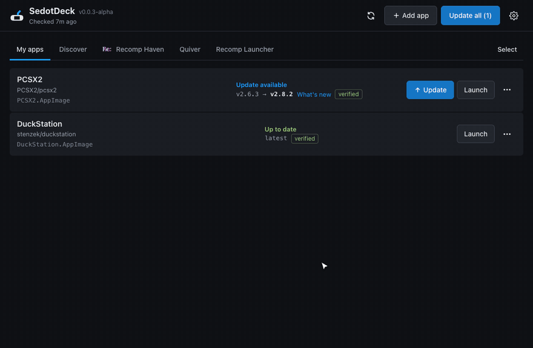
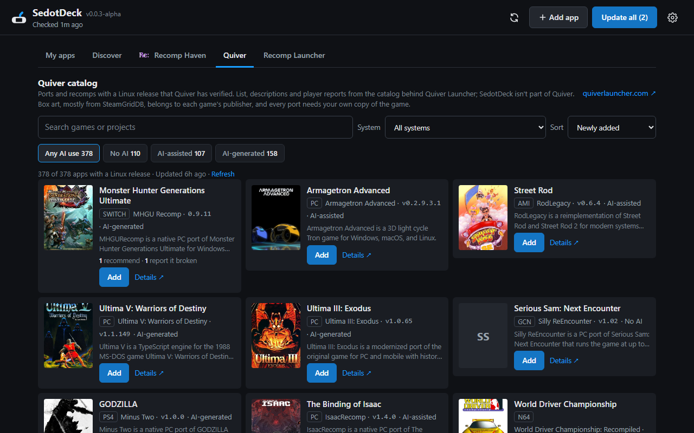
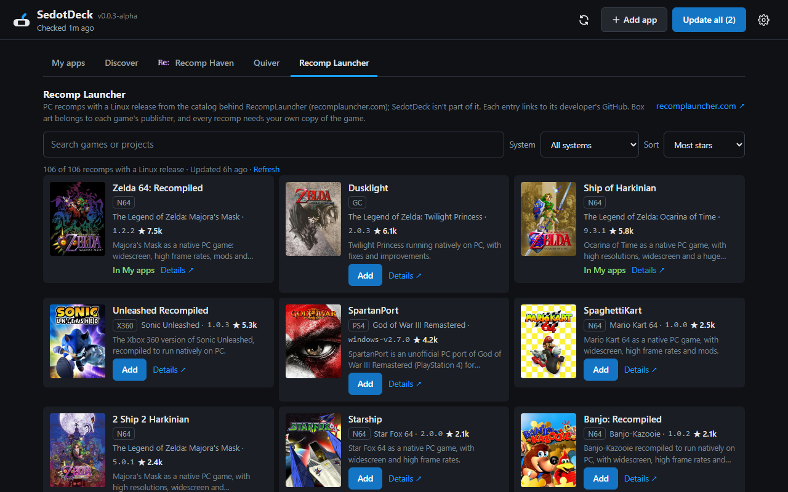

# SedotDeck

### Obtainium for Steam Deck

**Add a recomp, PC port or emulator once. SedotDeck keeps it updated and keeps it in your Steam library.**

[Why](#why-sedotdeck) · [Features](#features) · [Why not Quiver or Gear Lever?](#but-quiver-launcher-already-exists) · [Install](#install) · [Using it](#using-it) · [FAQ](#faq) · [Credit](#credit) · [License](#license)

> [!IMPORTANT]
> **SedotDeck is written by AI.** The code is written by [Claude](https://claude.com/claude-code), Anthropic's AI, through Claude Code. [intermission88](https://github.com/intermission88) is the maintainer: they decide what it does, review every change and test it on a Steam Deck.

> SedotDeck is in alpha (0.0.x).

## Why SedotDeck

Recomps and PC ports like Ship of Harkinian, Zelda64Recomp and OpenGOAL ship as releases on GitHub. On a Steam Deck, every new version means the same chores: open the release page, find the Linux file, download it, unzip it, mark it executable, and fix the Steam shortcut that just broke.

SedotDeck does all of that. Add a game once, press **Update all** from then on, and keep playing from Game Mode.

If you know [Obtainium](https://github.com/ImranR98/Obtainium) on Android, it's the same idea: apps come straight from their developers' release pages, with no store in between.

*Sedot* is Indonesian for "to slurp", as in slurping down the latest releases.

## Features

- **Update all in one click** for apps released on GitHub, GitLab, Codeberg, Gitea and Forgejo. SedotDeck picks the Linux file by itself (AppImage, `.flatpak` bundle, or a Linux build in a zip/tar).
- **Discover**: search GitHub for a game or port by name.
- **Catalog tabs**: browse recomps and PC ports with a Linux release from [Recomp Haven](https://recomphaven.com/), [Quiver](https://quiverlauncher.com/) and [Recomp Launcher](https://recomplauncher.com/), and add them in one click.
- **Steam shortcuts keep working**: file paths never change on update. **Add to Steam** works for AppImages, Flatpaks, folder ports and Windows `.exe` games through Proton.
- **Safe updates**: SHA-256 verification, a backup with **Rollback**, and saves and configs are never touched. A game that's still running isn't updated, and deleted files go to the Trash.
- **Controller support**: D-pad or left stick to move, A to select, B to go back, LB/RB to switch tabs.
- **Game Mode**: a Decky plugin that checks for updates every 6 hours.
- **Light**: one Python file on SteamOS's own Python. No `pip`, no `sudo`.

## "But Quiver Launcher already exists?"

[Quiver Launcher](https://github.com/tgeorgiadis/quiver-launcher) is a good launcher, and SedotDeck even includes its catalog as a tab. They solve different problems:

- **SedotDeck lives in Steam.** Quiver is a launcher: you open Quiver to play. SedotDeck puts each game in your Steam library and then stays out of the way. You play from Game Mode like any other game, and updates never break the shortcut.
- **Made only for the Deck.** A Decky plugin for Game Mode, controller navigation, Proton for Windows `.exe` builds, Flatpak bundles, and it runs on SteamOS's own Python with no `sudo`.
- **More sources in one list.** Quiver's catalog sits next to Recomp Haven, Recomp Launcher and a GitHub search, and any release page on GitHub, GitLab, Codeberg, Gitea or Forgejo works too.

Want one launcher for Windows, Linux and Android, a kiosk mode, or mods from Thunderstore and GameBanana? Quiver is the better fit there.

**And Gear Lever?** [Gear Lever](https://github.com/mijorus/gearlever) manages AppImages on the Linux desktop and adds them to your app menu. SedotDeck manages games: it also handles ports that ship as a zip, Windows `.exe` builds through Proton, Flatpak bundles, Steam shortcuts and Game Mode. For desktop apps in your app menu, use Gear Lever.

## Install

Downloads are on the [Releases](https://github.com/intermission88/SedotDeck/releases) page. All three share the same app list, so you can install more than one.

| Form | Runs in | How |
|---|---|---|
| **AppImage** (recommended) | Desktop Mode | Download `SedotDeck-x86_64.AppImage`, right-click → **Properties** → **Permissions** → tick **Is executable**, then double-click it. |
| **Decky plugin** | Game Mode | Needs [Decky Loader](https://decky.xyz). Turn on **Developer mode** in Decky's settings, then **Install Plugin from ZIP File** with `SedotDeck-decky-….zip` (don't unzip it). |
| **Script** | Desktop Mode | Copy this repository to the Deck and run `bash install.sh` in Konsole. Opens in a browser. |

## Using it

1. Press **Add app** and paste a release link (`owner/repo` works too), or press **Add** in **Discover** or one of the catalog tabs.
2. Check the file shown in the preview, then **Install**. From then on, **Update all** is enough.
3. **⋯** → **Add to Steam**, once. In Desktop Mode, close Steam first.

Wrong file or unwanted nightly builds? **⋯** → **Edit** → **Advanced** lets you pick the file and filter releases.

## FAQ

<b>"GitHub rate limit hit"</b>

Without a token GitHub allows 60 requests an hour. Create a read-only *fine-grained* token at <https://github.com/settings/tokens> and paste it in **Settings**.

<b>Why close Steam for "Add to Steam"?</b>

Steam overwrites `shortcuts.vdf` when it exits. In Game Mode this isn't needed: the Decky plugin uses Steam's own API.

<b>Where is my data?</b>

App list and settings in `~/.config/sedotdeck/`, games and apps in `~/Applications/`. SedotDeck sends no telemetry.

<b>Building it yourself</b>

All the logic is in [`sedotdeck.py`](sedotdeck.py) (Python standard library only). [`desktop/`](desktop) is the Tauri window and [`decky-plugin/`](decky-plugin) is the Game Mode plugin.

- AppImage: `cd desktop && npm ci && npm run build`
- Decky plugin: `decky-plugin/package.sh`
- Tests: `python3 -I tests/test_sedotdeck.py sedotdeck.py`

## Credit

- **Code**: [Claude](https://claude.com/claude-code) by Anthropic, through Claude Code. Commits made with Claude are marked `Co-Authored-By: Claude`. SedotDeck isn't made or endorsed by Anthropic.
- **Maintainer**: [intermission88](https://github.com/intermission88).
- **Catalog data**: [Recomp Haven](https://recomphaven.com/) by [rikuwru](https://github.com/rikuwru/recomphaven) (MIT), based on [Recompendium](https://github.com/nio03/unricopie) (MIT); the [quiverlauncher.com](https://quiverlauncher.com/) catalog by Thomas Georgiadis ([Quiver Launcher](https://github.com/tgeorgiadis/quiver-launcher)); and [RecompLauncher](https://recomplauncher.com/)'s public catalog. Their names and logos are their own marks, and box art belongs to each game's publisher.
- **Ideas**: [Obtainium](https://github.com/ImranR98/Obtainium) by ImranR98, the Android app that does this for APKs; moving deleted files to the Trash and not updating a running app come from [Gear Lever](https://github.com/mijorus/gearlever) by mijorus. Only ideas are borrowed, not code.
- **Built on**: [Tauri](https://v2.tauri.app), [Decky Loader](https://decky.xyz), [Flatpak](https://flatpak.org), [Proton](https://github.com/ValveSoftware/Proton). UI rules from [Anti Slop](https://github.com/miqdadbadjuber/anti-slop) (MIT).
- **The apps you install** belong to their own developers. Support them in their repositories.

Steam, Steam Deck, SteamOS and Proton are trademarks of Valve Corporation. SedotDeck is a fan-made tool and isn't affiliated with Valve, Decky Loader, Recomp Haven, Quiver, RecompLauncher, Obtainium or Gear Lever.

Found something of yours used here without proper credit? [Open an issue](https://github.com/intermission88/SedotDeck/issues).

## License

[MIT](LICENSE). This covers SedotDeck's own code, docs and logo; the data, box art and apps listed above keep their own licenses.
