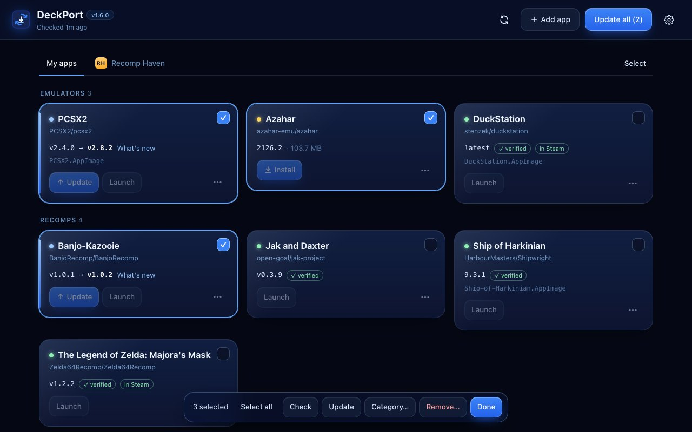
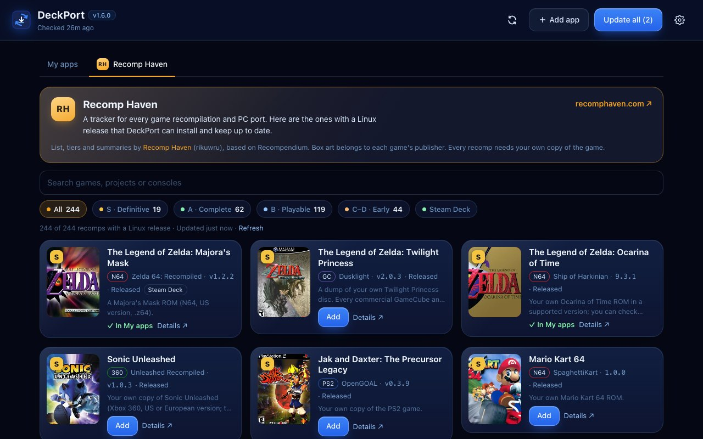
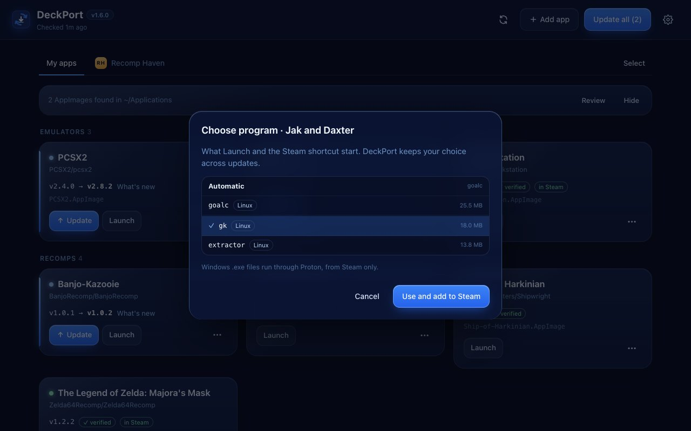
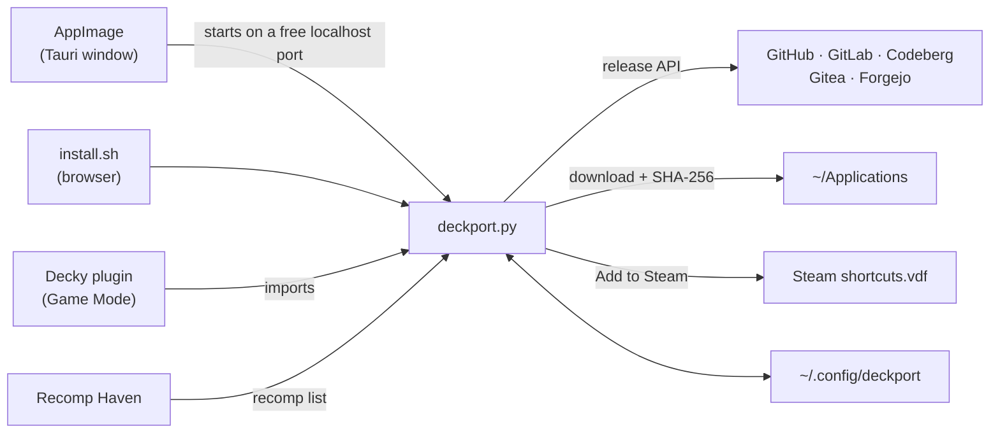

<div align="center">


# DeckPort

**Satu tempat untuk meng-update semua AppImage dan PC port di Steam Deck.**<br>
Tempel link rilisnya atau pilih recomp dari [Recomp Haven](https://recomphaven.com/). DeckPort yang cek, download, verifikasi, dan ganti file lamanya, tanpa merusak shortcut Steam.


[Install](#-install) · [Cara pakai](#-cara-pakai) · [Recomp Haven](#-recomp-haven) · [Port folder](#️-port-berbentuk-folder) · [FAQ](#-faq) · [Credit](#-credit)


</div>

## ✨ Fitur

- **Update all** sekali klik untuk semua emulator dan port, dari **GitHub, GitLab, Codeberg, Gitea, dan Forgejo**.
- **File Linux yang benar dipilih sendiri**: AppImage dulu, lalu build `linux`/`steamdeck` di zip/tar. Windows, macOS, ARM, dan Flatpak dilewati.
- **Path file tidak pernah berubah**, jadi shortcut Steam tetap jalan setelah update. Ada **Add to Steam** juga, termasuk untuk game Windows (`.exe`) lewat Proton.
- **Tab Recomp Haven**: ratusan recomp dan PC port dengan rilis Linux, tinggal klik **Add**.
- **AppImage yang sudah kamu punya** di `~/Applications` dikenali dan di-update di tempatnya.
- **Aman**: verifikasi SHA-256, backup `.old` dengan **Rollback**, dan save/config di port folder tidak tersentuh.
- **Kontrol rilis**: lewati rilis *nightly*, pakai hanya rilis **Latest**, **Skip** satu versi, dan baca **What's new** dulu.
- **Kategori** dan mode **Select** untuk mengurus banyak app sekaligus.
- **Plugin Decky** untuk Game Mode, dengan cek otomatis tiap 6 jam.
- **Ringan**: satu file Python dengan Python bawaan SteamOS. Tanpa `pip`, tanpa `sudo`.

## 🆕 Yang baru di v0.0.1-alpha

- **Tab Recomp Haven** dengan tier, cover, dan konsol. [Lihat](#-recomp-haven)
- **Port berbentuk folder** bisa masuk Steam, dengan **Choose program…** untuk memilih `.sh`, binary, atau `.exe`. [Lihat](#️-port-berbentuk-folder)
- **Skip releases named** dan **Only the release marked Latest** untuk memilih rilis. [Lihat](#memilih-rilis)
- **Repo pindah atau ganti nama** dikenali, dengan tombol **Use new link**.
- **Kategori dan mode Select.** Katalog bawaan diganti oleh Recomp Haven.

## 📦 Install

Ketiga bentuk memakai daftar app dan folder `~/Applications` yang sama, jadi boleh dipasang bersamaan. File-nya ada di [Releases](https://github.com/intermission88/deckport/releases).

| Bentuk | Dipakai di | Cocok untuk |
|---|---|---|
| **AppImage** `DeckPort-x.y.z-x86_64.AppImage` | Desktop Mode | Jendela sendiri, tanpa browser. **Direkomendasikan.** |
| **Plugin Decky** `DeckPort-decky-x.y.z.zip` | Game Mode | Update tanpa keluar dari Game Mode |
| **Script** `install.sh` | Desktop Mode | Paling ringan (±90 KB), tampil di browser |

<details open>
<summary><b>AppImage (Desktop Mode)</b></summary>

1. Download `DeckPort-…-x86_64.AppImage`.
2. Klik kanan → **Properties** → **Permissions**, centang **Is executable**.
3. Klik dua kali.

<br>
<sub>Diambil otomatis oleh CI dari AppImage yang berjalan di Linux.</sub>

Ukurannya sekitar 80 MB karena WebKitGTK ikut dibundel; dari sistem hanya butuh `python3`, yang sudah ada di SteamOS. AppImage ini juga bisa dipakai sebagai [CLI](#️-cli).
</details>

<details>
<summary><b>Plugin Decky (Game Mode)</b></summary>

Butuh [Decky Loader](https://decky.xyz).

1. Download `DeckPort-decky-….zip` ke Deck. **Jangan diekstrak.**
2. **⋯** → **Decky** → ⚙ **Settings** → **Developer**, aktifkan **Developer mode**.
3. **Install Plugin from ZIP File**, pilih file ZIP tadi.

Asset pattern dan GitHub token diatur dari versi Desktop dan ikut terpakai di plugin.
</details>

<details>
<summary><b>Script (install.sh)</b></summary>

Copy folder repo ini ke Deck (misalnya `~/deckport`), lalu di **Konsole**:

```bash
bash ~/deckport/install.sh
```

Buka **DeckPort** dari menu aplikasi (*Utilities*).
</details>

## 🚀 Cara pakai

1. Klik **Add app** dan tempel link repo-nya (`owner/repo` saja juga bisa), atau buka tab **Recomp Haven** dan klik **Add**.
2. Preview menunjukkan file yang akan di-download. Salah? Buka **Advanced** dan klik file yang benar.
3. **Install**, lalu untuk seterusnya cukup **Update all**.
4. **⋯** → **Add to Steam** sekali saja (di Desktop Mode, tutup Steam dulu; lihat [FAQ](#-faq)).

| Sedang download | Sudah terpasang |
|---|---|
|  |  |

Kartu hanya menampilkan status, versi, **Install/Update**, dan **Launch**. Sisanya (Check, Skip, Rollback, Add to Steam, Choose program, Category, Edit, Remove) ada di menu **⋯**.

### Kategori dan mode Select

Beri kategori lewat **⋯** → **Category…**, dan daftar app langsung dikelompokkan. Klik **Select**, pilih beberapa kartu, lalu **Check**, **Update**, **Category…**, atau **Remove…** sekaligus.



### Memilih rilis

Di **⋯** → **Edit** → **Advanced**. Preview langsung menunjukkan hasilnya.

| Opsi | Gunanya |
|---|---|
| **Skip releases named** | Lewati rilis yang judul atau tag-nya cocok dengan regex, misalnya `nightly\|beta`. |
| **Only the release marked "Latest"** | Pakai hanya rilis berlabel Latest dari developernya. |
| **Asset pattern** | Pilih file tertentu; klik file di daftar dan pattern-nya terisi sendiri. |
| **Include pre-releases** | Ikut memantau pre-release. |

## 🎮 Recomp Haven

[Recomp Haven](https://recomphaven.com/) melacak semua game recompilation dan PC port. Tab **Recomp Haven** di DeckPort menampilkan yang punya rilis Linux di GitHub, diurutkan dari tier terbaik.



- Cari per nama, project, atau konsol; saring per tier atau yang bertanda **Steam Deck**.
- **Add** memasukkannya ke **My apps**; **Details ↗** membuka halamannya di recomphaven.com.
- Project yang membagikan file game (ROM/ISO) tidak ditampilkan. Setiap recomp butuh salinan game milikmu sendiri.
- Project yang build Linux-nya hanya Flatpak (misalnya Sonic Unleashed Recompiled) belum bisa di-install.

## 🗂️ Port berbentuk folder

Port yang dirilis sebagai `.zip`/`.tar.gz` diekstrak ke `~/Applications/<Nama>/`. Saat update, file lama ditimpa tanpa menyentuh save dan config, dan launcher tetap `~/Applications/<Nama>.sh` dipakai untuk shortcut Steam.

**⋯** → **Choose program…** memilih program yang dijalankan, dan pilihan itu diingat setiap update. Contohnya OpenGOAL: pilih `gk` (game-nya), bukan `goalc` (compiler).



Memilih **`.exe`** berarti game Windows. Dari plugin Decky, Proton langsung diaktifkan. Dari Desktop Mode, aktifkan sendiri di Steam: **Properties** → **Compatibility** → **Force Proton**.

## 📁 Sudah punya AppImage-nya?

DeckPort memindai `~/Applications` dan mengenali AppImage dari info update yang tertanam di dalamnya (misalnya Vita3K dan PPSSPP).


Klik **Keep … up to date**: versi baru ditulis ke path dan nama file yang sama, jadi shortcut Steam-mu tetap jalan. File yang tidak dikenali bisa ditautkan lewat **Choose repo…** atau disembunyikan dengan **Hide**.

## ⌨️ CLI

<details>
<summary><b>Perintah <code>deckport</code></b> (dari <code>install.sh</code>) atau <code>./DeckPort-…AppImage</code></summary>

```bash
deckport add https://github.com/owner/repo --name "My Port"
deckport add <repo> --pattern 'linux.*\.AppImage$'   # pilih asset manual (regex)
deckport add <repo> --pre                            # ikut memantau pre-release
deckport add <repo> --adopt ~/Applications/Game-v1.1.AppImage
deckport list
deckport scan [--track]         # cari AppImage yang sudah ada di ~/Applications
deckport check
deckport update                 # update semua yang ada versi barunya
deckport update "My Port"       # update satu app
deckport remove "My Port" --delete-files
deckport export daftar.json     # backup/bagikan daftar app
deckport import daftar.json     # gabungkan; yang sudah ada dilewati
```
</details>

## ❓ FAQ

<details>
<summary><b>Muncul "GitHub rate limit hit"</b></summary>

Tanpa login, GitHub hanya mengizinkan 60 request per jam. Buat token *fine-grained* (akses *public repositories* read-only) di <https://github.com/settings/tokens> dan tempel di **⚙ Settings**. Token tidak pernah ikut di export.
</details>

<details>
<summary><b>DeckPort memilih file atau rilis yang salah</b></summary>

**⋯** → **Edit** → **Advanced**: klik file yang benar, atau isi **Skip releases named** (misalnya `nightly|beta`). Lihat [Memilih rilis](#memilih-rilis).
</details>

<details>
<summary><b>Port berbentuk folder tidak bisa di-Add to Steam</b></summary>

DeckPort belum tahu program mana yang dijalankan. Pilih **⋯** → **Choose program…** dan pilih `.sh`, binary, atau `.exe`-nya.
</details>

<details>
<summary><b>Kenapa harus menutup Steam untuk "Add to Steam"?</b></summary>

Steam menimpa `shortcuts.vdf` dari memorinya saat keluar. Di Desktop Mode, keluar dulu dari Steam, pilih **Add to Steam**, lalu buka Steam lagi. Salinan lama selalu disimpan sebagai `shortcuts.vdf.deckport.bak`. Di Game Mode tidak perlu: plugin Decky memakai API Steam.
</details>

<details>
<summary><b>AppImage tidak mau terbuka</b></summary>

Pastikan **Is executable** dicentang (atau `chmod +x DeckPort-*.AppImage`). Pesan *"DeckPort needs Python 3"* berarti sistemmu tidak punya `python3`; SteamOS sudah menyertakannya.
</details>

<details>
<summary><b>Data DeckPort disimpan di mana?</b></summary>

- Daftar app dan pengaturan: `~/.config/deckport/config.json`
- Cache Recomp Haven (sehari): `~/.config/deckport/recomphaven.json`
- File game: `~/Applications/` (bisa diganti di **⚙ Settings**)

DeckPort tidak mengirim telemetri. Yang dihubungi hanya API forge tempat rilisnya berada, dan Recomp Haven saat tab-nya dibuka.
</details>

## 🛠️ Cara kerja

<details>
<summary><b>Arsitektur dan build sendiri</b></summary>



Semua logika ada di [`deckport.py`](deckport.py) (hanya Python standard library). [`desktop/`](desktop) adalah cangkang Tauri yang menampilkan UI-nya di jendela native, dan [`decky-plugin/`](decky-plugin) memanggil kode yang sama dari Game Mode.

- **AppImage**: `cd desktop && npm ci && npm run build` (butuh Rust, Node.js, dan [dependensi Tauri](https://v2.tauri.app/start/prerequisites/#linux)).
- **Plugin Decky**: `decky-plugin/package.sh` (butuh Node.js 20+ dan `zip`).
- **Tes**: `python3 -I tests/test_deckport.py deckport.py`.

GitHub Actions mem-build keduanya di setiap push ke `main`, dan tag `v*` dipublish sebagai Release.
</details>

## 🙏 Credit

DeckPort berdiri di atas karya orang lain:

| Fitur | Credit |
|---|---|
| Tab Recomp Haven (daftar, tier, ringkasan, label konsol) | [Recomp Haven](https://recomphaven.com/) oleh [rikuwru](https://github.com/rikuwru/recomphaven) |
| Data dasar Recomp Haven | [Recompendium](https://github.com/nio03/unricopie) (MIT) |
| Box art di tab Recomp Haven | Milik publisher masing-masing game, dikumpulkan Recomp Haven dari [libretro thumbnails](https://thumbnails.libretro.com/) dan Wikipedia |
| Ide dasar DeckPort, filter judul rilis, rilis "Latest", deteksi repo pindah, kategori, dan aksi massal | [Obtainium](https://github.com/ImranR98/Obtainium) oleh ImranR98 |
| Pengenalan AppImage dari info update yang tertanam | Spesifikasi update information dari [AppImage](https://github.com/AppImage/AppImageSpec) |
| Jendela desktop (AppImage) | [Tauri](https://v2.tauri.app) dan WebKitGTK |
| Plugin Game Mode | [Decky Loader](https://decky.xyz) (`@decky/api`, `@decky/ui`) dan [react-icons](https://react-icons.github.io/react-icons/) |
| Game Windows lewat Proton | [Proton](https://github.com/ValveSoftware/Proton) oleh Valve |
| Kode, dokumentasi, dan screenshot | [Claude](https://claude.com/claude-code) oleh Anthropic (lihat di bawah) |

Emulator dan port yang kamu install lewat DeckPort adalah karya developer masing-masing. Dukung mereka di repo aslinya.

### 🤖 Dibuat dengan Claude

DeckPort dibuat menggunakan [Claude](https://claude.com/claude-code), model AI dari Anthropic, lewat Claude Code. Arah proyek dan keputusannya dari aku ([intermission88](https://github.com/intermission88)), dan setiap fiturnya aku tes sendiri. Commit yang dibuat dengan Claude bertanda `Co-Authored-By: Claude`.
