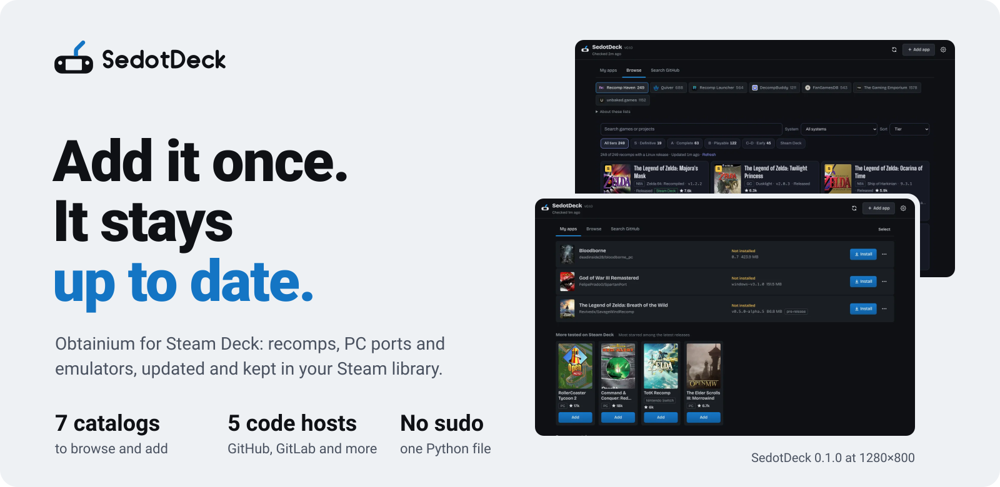
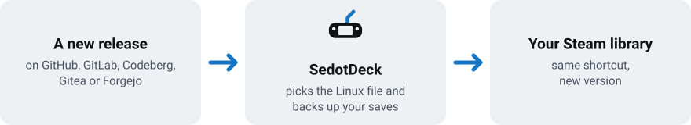

<h1>
<picture>
  <source media="(max-width: 600px) and (prefers-color-scheme: dark)" srcset="docs/assets/hero-phone-dark.svg">
  <source media="(max-width: 600px)" srcset="docs/assets/hero-phone-light.svg">
  <source media="(prefers-color-scheme: dark)" srcset="docs/assets/hero-dark.svg">
  
</picture>
</h1>

  
  

Not sure which one? Start with the AppImage: it has everything. Add the Decky plugin if you want updates from Game Mode. Both read the same app list, so nothing gets added twice ([what each one does](#appimage-or-decky-plugin)).

> [!IMPORTANT]
> **Written by AI.** [Claude](https://claude.com/claude-code) writes the code; [intermission88](https://github.com/intermission88) decides what it does, reviews every change and tests it on a Steam Deck.

## How it works

<picture>
  <source media="(max-width: 600px) and (prefers-color-scheme: dark)" srcset="docs/assets/flow-phone-dark.svg">
  <source media="(max-width: 600px)" srcset="docs/assets/flow-phone-light.svg">
  <source media="(prefers-color-scheme: dark)" srcset="docs/assets/flow-dark.svg">
  
</picture>

1. **Open SedotDeck.** For the AppImage, mark `SedotDeck-x86_64.AppImage` as executable first (right-click → Properties → Permissions).
2. **Add a game.** Press **Add app** and paste a repo link, or press **Add** on anything in **Browse**. Then **Install**.
3. **Put it in Steam,** once: **⋯ → Add to Steam**.
4. **Update all** whenever a new version is out. The Steam shortcut keeps working, because the path never changes.

## Features

- **Update all in one click** for releases on GitHub, GitLab, Codeberg, Gitea and Forgejo, pre-releases and nightlies too if you turn them on. SedotDeck picks the Linux file itself; a repo with only tags installs from the tag's source code.
- **Browse and add** from [Recomp Haven](https://recomphaven.com/), [Quiver](https://quiverlauncher.com/), [Recomp Launcher](https://recomplauncher.com/), [unbaked.games](https://unbaked.games/), [DecompBuddy](https://decompbuddy.com/), [FanGamesDB](https://fangamesdb.com/) and [The Gaming Emporium](https://thegamingemporium.com/), one catalog at a time and each in its own site's look, or search GitHub by the game's name.
- **Save backups**: pick a game's save folder once; SedotDeck zips it before every update and puts any backup back when you ask.
- **Steam shortcuts keep working**: paths never change on update. Works for AppImages, Flatpaks, zipped ports and Windows `.exe` through Proton.
- **Safe**: SHA-256 checks, Rollback, Uninstall to the Trash, running games left alone.
- **Made for the controller**: D-pad navigation with sound effects, and a Game Mode plugin for Decky.
- **No `pip`, no `sudo`**: one Python file on SteamOS's own Python.

## AppImage or Decky plugin?

|  | AppImage (Desktop Mode) | Decky plugin (Game Mode) |
|:--|:--:|:--:|
| **Install, Update all, Rollback, Uninstall** | ✓ | ✓ |
| **Add an app by its link** | ✓ | ✓ |
| **Browse the catalogs, Search GitHub** | ✓ | Not in the plugin |
| **Add to Steam** | Close Steam first | ✓, Steam stays open |
| **Pick a save folder, restore a backup** | ✓ | Not in the plugin |
| **Save backup before each update,** once a save folder is set | ✓ | ✓ |
| **Checks for updates** | When you open it | Every 6 hours, with a notification |
| **Settings and GitHub token** | ✓ | Not in the plugin |
| **Updates SedotDeck itself** | ✓ | Not in the plugin |

The Decky plugin is the quick panel; the AppImage is where you set things up. Both use the same `~/.config/sedotdeck` and `~/Applications`, so an app added in one shows up in the other.

**Installing the Decky plugin:** download `SedotDeck-decky-<version>.zip` from the [latest release](https://github.com/intermission88/SedotDeck/releases/latest). In [Decky](https://decky.xyz)'s settings, turn on Developer mode and use **Install Plugin from ZIP File**.

## Help

- **Found a bug?** [Open a bug report](https://github.com/intermission88/SedotDeck/issues/new?template=bug_report.yml). The form says which details to include.
- **What changed?** Each version is in the [changelog](CHANGELOG.md) and the [release notes](https://github.com/intermission88/SedotDeck/releases).

## FAQ

<b>Why not Quiver Launcher or Gear Lever?</b>

[Quiver Launcher](https://github.com/tgeorgiadis/quiver-launcher) is a launcher you open to play; SedotDeck puts games in your Steam library and stays out of the way. [Gear Lever](https://github.com/mijorus/gearlever) puts desktop AppImages in your app menu; SedotDeck handles games, including zipped ports, `.exe` builds and Game Mode.

<b>It picked the wrong file</b>

**⋯ → Edit** and set an **Asset pattern** (a regex), e.g. `x86_64\.AppImage$`. Without one, SedotDeck prefers an AppImage for Linux x86_64, and a PGO build when two files are otherwise equal.

<b>Why aren't recomphub.com and decomps.net in Browse?</b>

Their `robots.txt` asks programs to stay out of their API, which is the only way to read their lists. They'll be added if their owners agree.

<b>"GitHub rate limit hit"</b>

Paste a read-only fine-grained [GitHub token](https://github.com/settings/tokens) in **Settings**.

<b>Why close Steam for "Add to Steam"?</b>

Steam overwrites `shortcuts.vdf` when it exits. In Game Mode the Decky plugin uses Steam's own API, so there's no need.

<b>Where is my data?</b>

Settings in `~/.config/sedotdeck/`, games in `~/Applications/`, save backups in `~/Applications/Save backups/`. No telemetry.

<b>Building it yourself</b>

Logic is in [`sedotdeck.py`](sedotdeck.py) (stdlib only); [`desktop/`](desktop) is the Tauri window, [`decky-plugin/`](decky-plugin) the Game Mode plugin. You can also run `bash install.sh` to use it from a browser.

- AppImage: `cd desktop && npm ci && npm run build`
- Decky plugin: `decky-plugin/package.sh`
- Tests: `python3 -I tests/test_sedotdeck.py sedotdeck.py`

## Credit

- **Code** by [Claude](https://claude.com/claude-code) (Anthropic), commits marked `Co-Authored-By: Claude`. Not made or endorsed by Anthropic. **Maintainer**: [intermission88](https://github.com/intermission88).
- **Catalogs**: [Recomp Haven](https://github.com/rikuwru/recomphaven) by rikuwru (MIT, based on [Recompendium](https://github.com/nio03/unricopie)), [Quiver Launcher](https://github.com/tgeorgiadis/quiver-launcher) by Thomas Georgiadis, [RecompLauncher](https://recomplauncher.com/), [unbaked.games](https://unbaked.games/) (its public API), [DecompBuddy](https://github.com/TanookiStudios/decomp-buddy) by Tanooki Studios (catalog data GPL-3.0, read at runtime, not bundled), [FanGamesDB](https://fangamesdb.com/) and [The Gaming Emporium](https://thegamingemporium.com/). Names, logos and box art belong to their owners.
- **Ideas** (no code) from [Obtainium](https://github.com/ImranR98/Obtainium) by ImranR98 and [Gear Lever](https://github.com/mijorus/gearlever) by mijorus.
- **Built on** [Tauri](https://v2.tauri.app), [Decky Loader](https://decky.xyz), [Flatpak](https://flatpak.org), [Proton](https://github.com/ValveSoftware/Proton) and [Anti Slop](https://github.com/miqdadbadjuber/anti-slop) (MIT).

Steam, Steam Deck, SteamOS and Proton are trademarks of Valve Corporation. SedotDeck is fan-made and not affiliated with Valve or any project above. Something of yours not credited properly? [Open an issue](https://github.com/intermission88/SedotDeck/issues).

## License

[MIT](LICENSE) for SedotDeck's own code, docs and logo. Catalog data, box art and the apps you install keep their own licenses.
