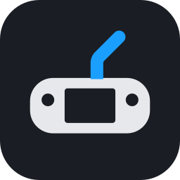
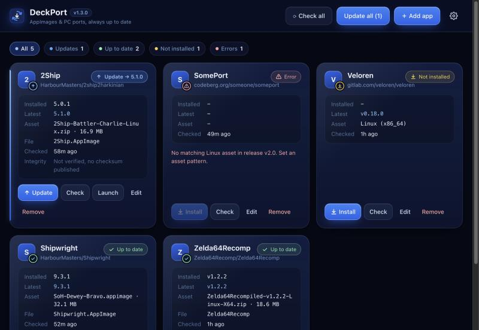
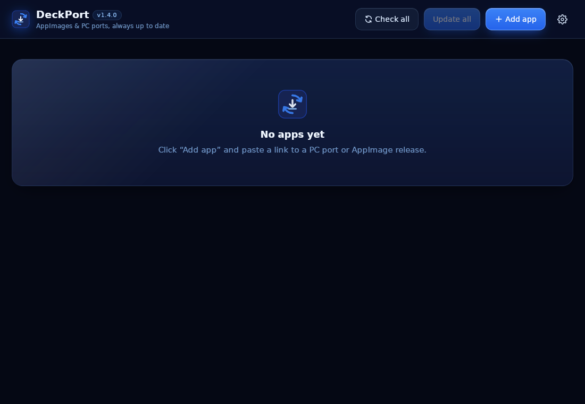
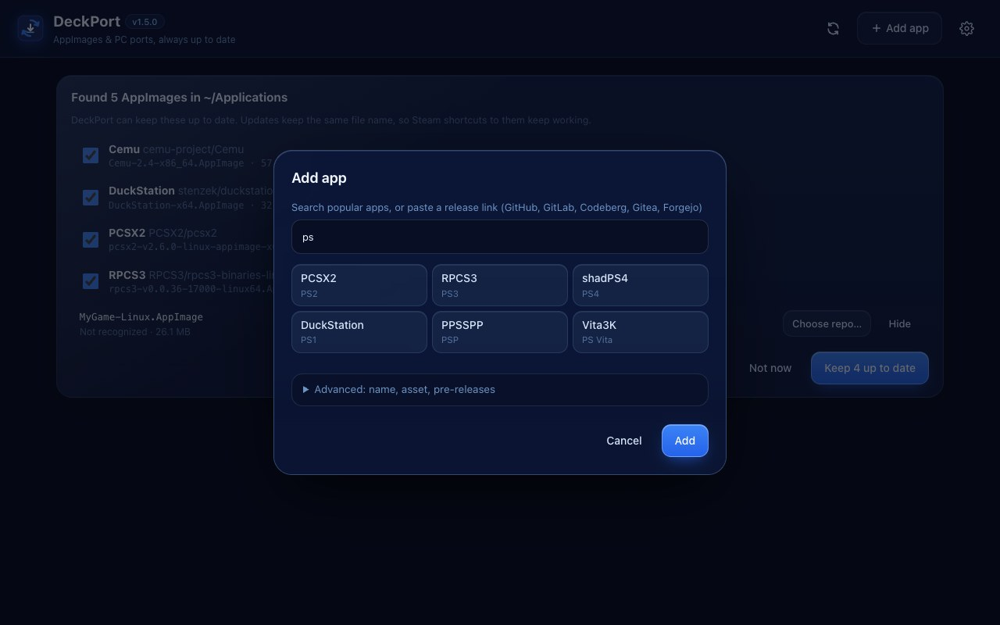
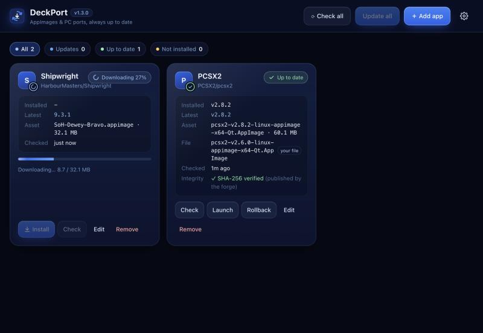
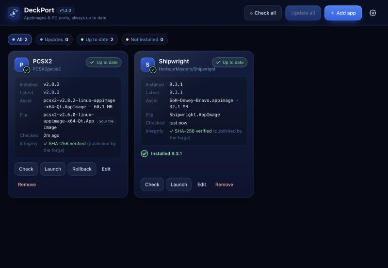
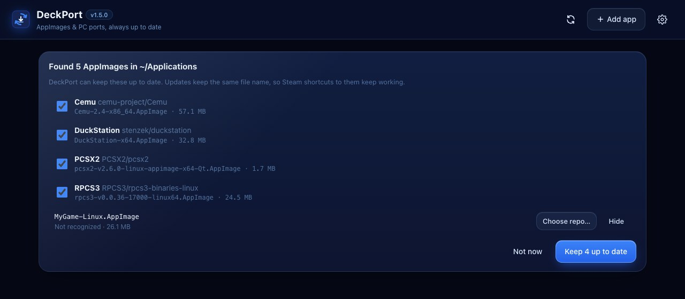
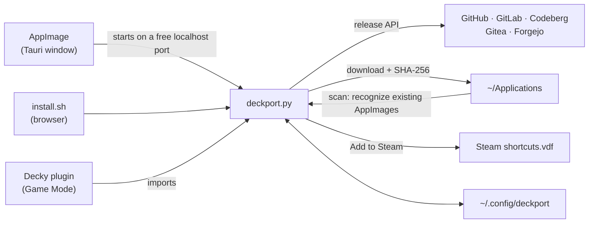

<div align="center">



# DeckPort

**Satu tempat untuk meng-update semua AppImage dan PC port di Steam Deck.**<br>
Mirip Obtainium, tapi untuk Steam Deck: pilih app-nya dari katalog atau tempel link rilisnya, DeckPort yang cek, download, verifikasi, dan ganti file lamanya.


[Install](#-install) · [Cara pakai](#-cara-pakai) · [Katalog](#-katalog-app) · [Sudah punya AppImage?](#-sudah-punya-appimage-nya) · [CLI](#-cli) · [FAQ](#-faq)



</div>

## Kenapa DeckPort?

PC port dan emulator di GitHub rilis update terus. Tanpa DeckPort, setiap update berarti buka GitHub, cari file Linux yang benar, download, ganti file lama, lalu berharap shortcut Steam-mu masih jalan.

DeckPort mengerjakan semua itu dengan satu klik **Update all**, atau bahkan otomatis dari Game Mode.

## 🆕 Yang baru di v1.5.0

- **AppImage yang sudah ada langsung ketemu.** DeckPort memindai `~/Applications` dan menawarkan untuk meng-update file-file itu di tempatnya. Tidak perlu lagi tempel link dulu. [Selengkapnya](#-sudah-punya-appimage-nya)
- **Katalog 17 app populer** di dialog **Add app**: ketik `pcsx2`, klik, selesai. [Daftarnya](#-katalog-app)
- **Add to Steam** dari Desktop Mode maupun dari plugin Decky di Game Mode.
- **What's new** untuk membaca catatan rilis, dan **Skip** untuk melewati satu versi.
- DeckPort **cek update sendiri** saat dibuka, dan **Settings** menunjukkan pemakaian disk serta bisa menghapus backup `.old`.
- Dialog **Add app** lebih ringkas: preview jalan sendiri, opsi lanjutan pindah ke **Advanced**, dan tombolnya selalu kelihatan di layar Deck.
- Pemilihan file lebih tepat: build *debug* dilewati (xemu), AppImage di dalam zip dikenali (melonDS), build x64 diutamakan di atas SSE2 (DuckStation).

## ✨ Fitur

**Update tanpa ribet**
- **Katalog app populer** (PCSX2, RPCS3, shadPS4, DuckStation, PPSSPP, Cemu, Azahar, xemu, ES-DE, Heroic, dan lainnya): ketik namanya di **Add app**, klik, selesai. Tidak perlu cari link.
- Mendukung **GitHub, GitLab, Codeberg, Gitea, dan Forgejo**. Server self-hosted pun dideteksi otomatis.
- **Memilih file Linux yang benar dengan sendirinya**: AppImage dulu, lalu build `linux`/`steamdeck` di zip/tar. Build Windows, macOS, ARM, dan Flatpak dilewati. Kalau perlu, pilihannya bisa diatur dengan regex.
- Rilis *nightly* atau *continuous* tetap terdeteksi, walaupun nama tag-nya sama.
- **Update all** sekali klik, dengan progress per app. DeckPort juga cek update sendiri saat dibuka (paling sering sejam sekali).
- **What's new**: baca catatan rilis sebelum meng-update. Ada rilis yang bermasalah? **Skip** versi itu, dan DeckPort baru mengabari lagi saat versi berikutnya keluar.

**Ramah Steam**
- **Path file tidak berubah** (`~/Applications/NamaGame.AppImage`), jadi shortcut *Non-Steam Game* tidak rusak setelah update.
- **Menemukan AppImage yang sudah kamu punya**: DeckPort memindai `~/Applications`, mengenali app-nya, lalu menawarkan untuk meng-update file itu di tempatnya, dengan nama yang sama. Cukup satu klik.
- **Add to Steam**: jadikan app sebagai *Non-Steam Game* langsung dari DeckPort, tanpa lewat menu Steam.
- **Plugin Decky** untuk Game Mode: update dan *Add to Steam library* tanpa pindah ke Desktop, ditambah cek otomatis tiap 6 jam dengan notifikasi.

**Aman**
- **Verifikasi SHA-256** memakai checksum dari GitHub atau dari file checksum di rilis (`SHA256SUMS`, `*.sha256`). Kalau tidak cocok, download dihapus dan versi lama tetap dipakai.
- Versi sebelumnya disimpan sebagai `.old` dan bisa di-**Rollback** dengan satu klik.
- App yang sudah versi terbaru **tidak bisa ter-install ulang** tanpa sengaja.
- Port berbentuk folder di-update dengan cara menimpa file, jadi **save dan config tidak terhapus**.

**Ringan**
- Logikanya hanya satu file Python yang memakai Python bawaan SteamOS. Tidak perlu `pip`, tidak perlu `sudo`, dan tetap aman setelah SteamOS update.
- UI *liquid glass* gelap yang tetap ringan: efek blur hanya di header dan dialog, dan animasinya cuma jalan sekali.
- Daftar app bisa di-**export/import** ke JSON untuk backup atau dibagikan ke teman. Token dan path lokal tidak ikut.
- **Settings** menunjukkan berapa ruang disk yang dipakai, dan bisa menghapus semua backup `.old` sekaligus.

## 📦 Install

DeckPort tersedia dalam tiga bentuk. Ketiganya memakai daftar app dan folder `~/Applications` yang sama, jadi boleh dipasang bersamaan.

| Bentuk | Dipakai di | Cocok untuk |
|---|---|---|
| **AppImage**<br>`DeckPort-x.y.z-x86_64.AppImage` | Desktop Mode | Aplikasi dengan jendela sendiri, tanpa browser. **Direkomendasikan.** |
| **Plugin Decky**<br>`DeckPort-decky-x.y.z.zip` | Game Mode (menu ⋯) | Update tanpa keluar dari Game Mode, dengan notifikasi otomatis |
| **Script**<br>`install.sh` | Desktop Mode | Paling ringan (±90 KB), tapi tampil di browser |

File AppImage dan ZIP Decky ada di halaman **Releases**, atau di artifact **appimage** / **decky** pada run terbaru di tab **Actions**.

<details open>
<summary><b>AppImage (Desktop Mode)</b></summary>

1. Masuk **Desktop Mode**, lalu download `DeckPort-…-x86_64.AppImage`.
2. Klik kanan file-nya, pilih **Properties** → **Permissions**, lalu centang **Is executable**.
3. Klik dua kali. DeckPort terbuka di jendelanya sendiri.

<br>
<sub>Screenshot ini diambil otomatis oleh CI dari AppImage yang dijalankan di Linux, jadi tanpa title bar.</sub>

- Ukurannya sekitar 80 MB karena mesin tampilannya (WebKitGTK, lewat Tauri) ikut dibundel. Yang dibutuhkan dari sistem cuma `python3`, dan itu sudah ada di SteamOS.
- Begitu jendelanya ditutup, DeckPort langsung berhenti. Kalau saat itu sedang ada download, download-nya diselesaikan dulu.
- AppImage ini juga bisa dipakai sebagai CLI, misalnya `./DeckPort-…AppImage update`.
</details>

<details>
<summary><b>Plugin Decky (Game Mode)</b></summary>

Butuh [Decky Loader](https://decky.xyz) yang sudah terpasang.

1. Download `DeckPort-decky-….zip` ke Deck. **Jangan diekstrak.**
2. Di Game Mode, buka **⋯** → **Decky** → ⚙ **Settings** → **Developer**, lalu aktifkan **Developer mode**.
3. Pilih **Install Plugin from ZIP File**, lalu pilih file ZIP tadi.
4. DeckPort muncul di daftar plugin. Isinya **Update all**, **Check for updates**, AppImage yang ditemukan di `~/Applications`, daftar app (tekan sebuah app untuk Check, Skip, Add to Steam library, Rollback, atau Remove), dan kolom **Add app**.

Asset pattern dan GitHub token diatur dari versi Desktop, lalu otomatis ikut terpakai di plugin.
</details>

<details>
<summary><b>Script (install.sh)</b></summary>

Masuk **Desktop Mode**, copy folder repo ini ke Deck (misalnya ke `~/deckport`), lalu jalankan di **Konsole**:

```bash
bash ~/deckport/install.sh
```

Setelah itu buka **DeckPort** dari menu aplikasi (*Utilities*) atau dari ikon di Desktop. Versi ini terbuka di browser.
</details>

## 🚀 Cara pakai

1. Klik **Add app**, lalu ketik nama app-nya (misalnya `pcsx2`) dan klik hasilnya. App yang tidak ada di katalog? Tempel link repo-nya, misalnya `https://github.com/owner/repo`, `https://gitlab.com/group/project`, atau `https://codeberg.org/owner/repo`.
2. DeckPort langsung menunjukkan file mana yang akan di-download. Kalau pilihannya salah, buka **Advanced** dan klik file yang benar.
3. Klik **Add**, lalu **Install**. Untuk seterusnya, cukup **Update all**.
4. **Supaya bisa dimainkan dari Game Mode:** klik **Add to Steam** di kartu app-nya (tutup Steam dulu, lihat [FAQ](#-faq)), atau dari Game Mode lewat plugin Decky. Cukup sekali saja, karena path file-nya tidak pernah berubah.



### Arti status

| Status | Tampilan | Artinya |
|---|---|---|
| **Update → v1.2** | ↑ biru, dengan garis aksen | Ada versi baru. Klik **Update**. |
| **Up to date** | ✓ hijau | Sudah versi terbaru. Tombol Install/Update tidak muncul. |
| **Skipped v1.2** | ✓ hijau | Kamu memilih **Skip** untuk versi itu. Klik *undo skip* untuk membatalkan. |
| **Not installed** | ↓ kuning | Sudah dilacak tapi belum di-download, atau file-nya sudah kamu hapus. |
| **Error** | ⚠ merah | Misalnya tidak ada file Linux di rilis itu. Pilih file yang benar lewat **Edit** → **Advanced**. |
| **Downloading 45%** | spinner | Sedang proses. Launch dan Rollback dinonaktifkan sampai selesai. |

App yang butuh update selalu tampil paling atas. Chip di atas daftar (**All · Updates · Up to date · Not installed**) bisa dipakai untuk memfilter.

| Sedang download | Sudah terpasang |
|---|---|
|  |  |

## 📚 Katalog app

Ketik namanya (atau konsolnya, misalnya `ps2` atau `3ds`) di **Add app**. Semua repo di bawah ini sudah dicek punya build Linux yang dipilih DeckPort dengan benar.

| App | Untuk | Repo |
|---|---|---|
| PCSX2 | PS2 | [PCSX2/pcsx2](https://github.com/PCSX2/pcsx2) |
| RPCS3 | PS3 | [RPCS3/rpcs3-binaries-linux](https://github.com/RPCS3/rpcs3-binaries-linux) |
| shadPS4 | PS4 | [shadps4-emu/shadPS4](https://github.com/shadps4-emu/shadPS4) |
| DuckStation | PS1 | [stenzek/duckstation](https://github.com/stenzek/duckstation) |
| PPSSPP | PSP | [hrydgard/ppsspp](https://github.com/hrydgard/ppsspp) |
| Vita3K | PS Vita | [Vita3K/Vita3K](https://github.com/Vita3K/Vita3K) |
| Cemu | Wii U | [cemu-project/Cemu](https://github.com/cemu-project/Cemu) |
| Azahar | 3DS | [azahar-emu/azahar](https://github.com/azahar-emu/azahar) |
| melonDS | DS | [melonDS-emu/melonDS](https://github.com/melonDS-emu/melonDS) |
| mGBA | GBA | [mgba-emu/mgba](https://github.com/mgba-emu/mgba) |
| xemu | Xbox | [xemu-project/xemu](https://github.com/xemu-project/xemu) |
| Flycast | Dreamcast | [flyinghead/flycast](https://github.com/flyinghead/flycast) |
| ES-DE | Frontend | [es-de/emulationstation-de](https://gitlab.com/es-de/emulationstation-de) (GitLab) |
| Heroic | Launcher Epic/GOG | [Heroic-Games-Launcher/HeroicGamesLauncher](https://github.com/Heroic-Games-Launcher/HeroicGamesLauncher) |
| Ship of Harkinian | Port Ocarina of Time | [HarbourMasters/Shipwright](https://github.com/HarbourMasters/Shipwright) |
| 2 Ship 2 Harkinian | Port Majora's Mask | [HarbourMasters/2ship2harkinian](https://github.com/HarbourMasters/2ship2harkinian) |
| Zelda 64: Recompiled | Recomp Majora's Mask | [Zelda64Recomp/Zelda64Recomp](https://github.com/Zelda64Recomp/Zelda64Recomp) |

App lain tetap bisa ditambahkan dengan menempel link repo-nya.

## 📁 Sudah punya AppImage-nya?

Banyak orang sudah punya, misalnya `pcsx2-v2.6.0-linux-appimage-x64-Qt.AppImage` di `~/Applications` yang sudah dijadikan shortcut Steam. Tidak perlu apa-apa: saat dibuka, DeckPort memindai folder itu dan menampilkan file yang bisa ia jaga.



- Klik **Keep … up to date**. DeckPort lalu mengecek versinya (lewat SHA-256): kalau sudah terbaru statusnya langsung *Up to date*, kalau belum tinggal klik **Update**.
- Versi baru ditulis ke **path dan nama file yang sama**, jadi shortcut Steam-mu tetap jalan. Yang lama disimpan sebagai `.old`.
- Cara DeckPort mengenali file: pertama dari info update yang tertanam di AppImage (misalnya Vita3K dan PPSSPP), lalu dari nama file yang dicocokkan dengan katalog.
- File yang tidak dikenali? Klik **Choose repo…** lalu pilih app-nya atau tempel link-nya. Atau klik **Hide** kalau memang tidak mau dilacak (bisa dimunculkan lagi di **⚙ Settings**).

Lewat CLI:

```bash
deckport scan            # lihat file apa saja yang ditemukan
deckport scan --track    # lacak semua yang dikenali
deckport add https://github.com/PCSX2/pcsx2 --adopt ~/Applications/pcsx2-v2.6.0-linux-appimage-x64-Qt.AppImage
```

## ⌨️ CLI

Perintah `deckport` (dari `install.sh`) atau `./DeckPort-…AppImage`:

```bash
deckport add https://github.com/owner/repo --name "My Port"
deckport add <repo> --pattern 'linux.*\.AppImage$'   # pilih asset manual (regex)
deckport add <repo> --pre                            # ikut memantau pre-release
deckport add <repo> --adopt ~/Applications/Game-v1.1.AppImage
deckport list
deckport scan [--track]         # cari AppImage yang sudah ada di ~/Applications
deckport check
deckport update                 # update semua yang ada versi barunya
deckport update "My Port"       # update satu app
deckport remove "My Port" --delete-files
deckport export daftar.json     # backup/bagikan daftar app
deckport import daftar.json     # gabungkan; yang sudah ada dilewati
```

## ❓ FAQ

<details>
<summary><b>Muncul "GitHub rate limit hit"</b></summary>

Tanpa login, GitHub hanya mengizinkan 60 request per jam. Buat token di <https://github.com/settings/tokens> (tipe *fine-grained*, akses *public repositories* read-only sudah cukup), lalu tempel di **⚙ Settings**. Batasnya naik jadi 5000 request per jam. Token disimpan di `~/.config/deckport/config.json` (hanya bisa dibaca oleh user-mu) dan tidak pernah ikut di export.
</details>

<details>
<summary><b>DeckPort memilih file yang salah</b></summary>

Buka **Edit**, lalu di bagian **Advanced** klik file yang benar. Pattern regex-nya akan terisi otomatis, dengan bagian versinya diganti wildcard supaya tetap cocok untuk rilis berikutnya.
</details>

<details>
<summary><b>AppImage tidak mau terbuka</b></summary>

Pastikan **Is executable** sudah dicentang (lewat Properties → Permissions, atau jalankan `chmod +x DeckPort-*.AppImage`). Kalau muncul pesan *"DeckPort needs Python 3"*, berarti sistemmu tidak punya `python3`. SteamOS sudah menyertakannya, jadi pesan ini biasanya hanya muncul di distro lain.
</details>

<details>
<summary><b>Shortcut Steam-ku masih menjalankan versi lama</b></summary>

Cek baris **File** di kartu app. Shortcut Steam harus mengarah ke file itu. Kalau shortcut-mu mengarah ke file lain (misalnya yang dulu kamu download manual), pakai fitur [Sudah punya AppImage?](#-sudah-punya-appimage-nya) supaya DeckPort meng-update file tersebut.
</details>

<details>
<summary><b>Kenapa harus menutup Steam untuk "Add to Steam"?</b></summary>

Steam menyimpan daftar *Non-Steam Game* di `shortcuts.vdf`, dan menimpa file itu dari memorinya saat keluar. Jadi di Desktop Mode, keluar dulu dari Steam (menu **Steam** → **Exit**), klik **Add to Steam**, lalu buka Steam lagi. Sebelum mengubah file itu, DeckPort selalu menyimpan salinannya sebagai `shortcuts.vdf.deckport.bak`.

Di Game Mode tidak perlu: plugin Decky memakai API Steam sendiri (tekan app-nya → **Add to Steam library**).
</details>

<details>
<summary><b>Data DeckPort disimpan di mana?</b></summary>

- Daftar app dan pengaturan: `~/.config/deckport/config.json`
- File game: `~/Applications/` (bisa diganti di **⚙ Settings**)
- Shortcut Steam: DeckPort hanya mengubah `~/.steam/steam/userdata/<id>/config/shortcuts.vdf` saat kamu menekan **Add to Steam**, dan selalu menyimpan salinan sebelumnya sebagai `shortcuts.vdf.deckport.bak`.

Ketiga bentuk DeckPort (AppImage, Decky, script) membaca file yang sama. DeckPort tidak mengirim telemetri; yang dihubungi hanya API forge tempat rilisnya berada.
</details>

## 🛠️ Cara kerja



Semua logika ada di [`deckport.py`](deckport.py), yang hanya memakai Python standard library (termasuk katalog app, pemindai folder, dan penulis `shortcuts.vdf`). AppImage-nya hanyalah cangkang [Tauri](https://v2.tauri.app) ([`desktop/`](desktop)) yang menjalankan script itu dan menampilkan UI-nya di jendela native. Plugin Decky ([`decky-plugin/`](decky-plugin)) memanggil kode yang sama.

<details>
<summary><b>Build sendiri</b></summary>

- **AppImage** (Linux x86_64): `cd desktop && npm ci && npm run build`. Butuh Rust, Node.js, dan [dependensi Tauri](https://v2.tauri.app/start/prerequisites/#linux). Hasilnya ada di `desktop/src-tauri/target/release/bundle/appimage/`. Untuk mencoba langsung: `npm run dev`.
- **Plugin Decky**: `decky-plugin/package.sh` (butuh Node.js 20+ dan `zip`).
- **Tes**: `python3 -I tests/test_deckport.py deckport.py`.

GitHub Actions mem-build AppImage (di Ubuntu 22.04, supaya kompatibel dengan SteamOS) dan plugin Decky di setiap push ke `main`. Selain itu, CI juga menjalankan AppImage di layar virtual untuk memastikan jendelanya bisa terbuka. Tag `v*` otomatis dipublish sebagai Release.
</details>
