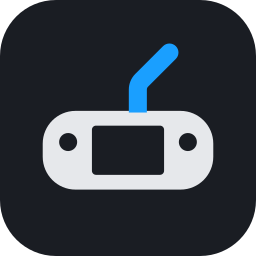
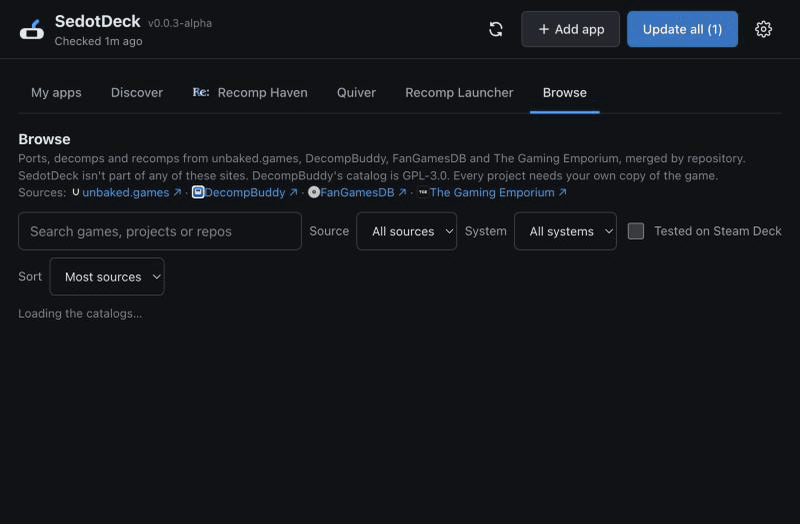

# SedotDeck

### Obtainium for Steam Deck

**Add a recomp, PC port or emulator once. SedotDeck keeps it updated and keeps it in your Steam library.**

> [!IMPORTANT]
> **Written by AI, in alpha.** [Claude](https://claude.com/claude-code) writes the code; [intermission88](https://github.com/intermission88) decides what it does, reviews every change and tests it on a Steam Deck.

## Features

- **Update all in one click** for releases on GitHub, GitLab, Codeberg, Gitea and Forgejo, pre-releases and nightlies too if you turn them on. SedotDeck picks the Linux file itself; a repo with only tags installs from the tag's source code.
- **Browse and add** from one list that merges [Recomp Haven](https://recomphaven.com/), [Quiver](https://quiverlauncher.com/), [Recomp Launcher](https://recomplauncher.com/), [unbaked.games](https://unbaked.games/), [DecompBuddy](https://decompbuddy.com/), [FanGamesDB](https://fangamesdb.com/) and [The Gaming Emporium](https://thegamingemporium.com/) by repository, or search GitHub. Pick Recomp Haven, Quiver or Recomp Launcher as the source for its tiers and filters.
- **Steam shortcuts keep working**: paths never change on update. Works for AppImages, Flatpaks, zipped ports and Windows `.exe` through Proton.
- **Safe**: SHA-256 checks, Rollback, saves untouched, running games left alone.
- **Game Mode** plugin for Decky, with controller support.
- **No `pip`, no `sudo`**: one Python file on SteamOS's own Python.

## Install

Get it from [Releases](https://github.com/intermission88/SedotDeck/releases):

- **AppImage** (Desktop Mode): mark `SedotDeck-x86_64.AppImage` as executable (right-click → Properties → Permissions), then open it.
- **Decky plugin** (Game Mode): in [Decky](https://decky.xyz) settings, turn on Developer mode and use **Install Plugin from ZIP File**.

Then press **Add app**, or **Add** in Browse, and **Install**. **⋯ → Add to Steam** once, and **Update all** from then on.

## FAQ

<b>Why not Quiver Launcher or Gear Lever?</b>

[Quiver Launcher](https://github.com/tgeorgiadis/quiver-launcher) is a launcher you open to play; SedotDeck puts games in your Steam library and stays out of the way. [Gear Lever](https://github.com/mijorus/gearlever) puts desktop AppImages in your app menu; SedotDeck handles games, including zipped ports, `.exe` builds and Game Mode.

<b>It picked the wrong file</b>

**⋯ → Edit** and set an **Asset pattern** (a regex), e.g. `x86_64\.AppImage$`. Without one, SedotDeck prefers an AppImage for Linux x86_64, and a PGO build when two files are otherwise equal.

<b>Why aren't recomphub.com and decomps.net in Browse?</b>

Their `robots.txt` asks programs to stay out of their API, which is the only way to read their lists. They'll be added if their owners agree.

<b>"GitHub rate limit hit"</b>

Paste a read-only fine-grained [GitHub token](https://github.com/settings/tokens) in **Settings**.

<b>Why close Steam for "Add to Steam"?</b>

Steam overwrites `shortcuts.vdf` when it exits. In Game Mode the Decky plugin uses Steam's own API, so there's no need.

<b>Where is my data?</b>

Settings in `~/.config/sedotdeck/`, games in `~/Applications/`. No telemetry.

<b>Building it yourself</b>

Logic is in [`sedotdeck.py`](sedotdeck.py) (stdlib only); [`desktop/`](desktop) is the Tauri window, [`decky-plugin/`](decky-plugin) the Game Mode plugin. You can also run `bash install.sh` to use it from a browser.

- AppImage: `cd desktop && npm ci && npm run build`
- Decky plugin: `decky-plugin/package.sh`
- Tests: `python3 -I tests/test_sedotdeck.py sedotdeck.py`

## Credit

- **Code** by [Claude](https://claude.com/claude-code) (Anthropic), commits marked `Co-Authored-By: Claude`. Not made or endorsed by Anthropic. **Maintainer**: [intermission88](https://github.com/intermission88).
- **Catalogs**: [Recomp Haven](https://github.com/rikuwru/recomphaven) by rikuwru (MIT, based on [Recompendium](https://github.com/nio03/unricopie)), [Quiver Launcher](https://github.com/tgeorgiadis/quiver-launcher) by Thomas Georgiadis, [RecompLauncher](https://recomplauncher.com/), [unbaked.games](https://unbaked.games/) (its public API), [DecompBuddy](https://github.com/TanookiStudios/decomp-buddy) by Tanooki Studios (catalog data GPL-3.0, read at runtime, not bundled), [FanGamesDB](https://fangamesdb.com/) and [The Gaming Emporium](https://thegamingemporium.com/). Names, logos and box art belong to their owners.
- **Ideas** (no code) from [Obtainium](https://github.com/ImranR98/Obtainium) by ImranR98 and [Gear Lever](https://github.com/mijorus/gearlever) by mijorus.
- **Built on** [Tauri](https://v2.tauri.app), [Decky Loader](https://decky.xyz), [Flatpak](https://flatpak.org), [Proton](https://github.com/ValveSoftware/Proton) and [Anti Slop](https://github.com/miqdadbadjuber/anti-slop) (MIT).

Steam, Steam Deck, SteamOS and Proton are trademarks of Valve Corporation. SedotDeck is fan-made and not affiliated with Valve or any project above. Something of yours not credited properly? [Open an issue](https://github.com/intermission88/SedotDeck/issues).

## License

[MIT](LICENSE) for SedotDeck's own code, docs and logo. Catalog data, box art and the apps you install keep their own licenses.
