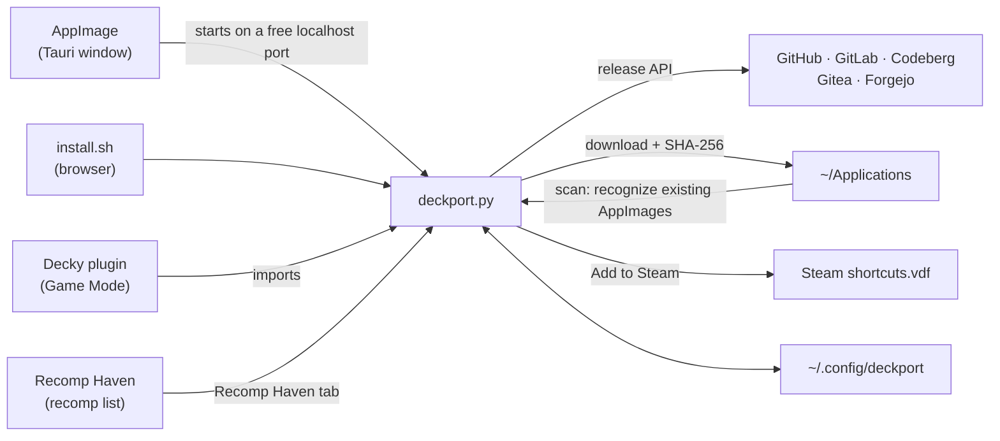

<div align="center">


# DeckPort

**Satu tempat untuk meng-update semua AppImage dan PC port di Steam Deck.**<br>
Mirip Obtainium, tapi untuk Steam Deck: tempel link rilisnya atau pilih recomp dari [Recomp Haven](https://recomphaven.com/), DeckPort yang cek, download, verifikasi, dan ganti file lamanya.


[Install](#-install) · [Cara pakai](#-cara-pakai) · [Recomp Haven](#-recomp-haven) · [Port berbentuk folder](#-port-berbentuk-folder-zip--targz) · [Sudah punya AppImage?](#-sudah-punya-appimage-nya) · [CLI](#-cli) · [FAQ](#-faq)


</div>

## Kenapa DeckPort?

PC port dan emulator di GitHub rilis update terus. Tanpa DeckPort, setiap update berarti buka GitHub, cari file Linux yang benar, download, ganti file lama, lalu berharap shortcut Steam-mu masih jalan.

DeckPort mengerjakan semua itu dengan satu klik **Update all**, atau bahkan otomatis dari Game Mode.

## 🆕 Yang baru (di `main`, belum dirilis)

- **Tab Recomp Haven.** Jelajahi ratusan recomp dan PC port yang punya rilis Linux, lengkap dengan tier, cover, dan konsolnya, lalu tambahkan dengan satu klik. Datanya dari [Recomp Haven](https://recomphaven.com/). [Selengkapnya](#-recomp-haven)
- **Port berbentuk folder bisa masuk Steam.** Pilih sendiri program yang dijalankan (`.sh`, binary Linux, atau `.exe` lewat Proton) dengan **Choose program…**. [Selengkapnya](#-port-berbentuk-folder-zip--targz)
- **Pilih rilis dengan lebih teliti:** lewati rilis bernama *nightly* atau *beta* dengan regex, atau pakai hanya rilis yang ditandai **Latest** oleh developernya.
- **Repo pindah atau ganti nama?** Kartu app menawarkan **Use new link**.
- **Kategori dan mode Select:** kelompokkan app-mu, lalu Check, Update, ubah kategori, atau Remove beberapa app sekaligus.
- Katalog 17 app bawaan dihapus, digantikan oleh Recomp Haven dan link repo.

<details>
<summary><b>Yang baru di v1.5.0</b></summary>

- **AppImage yang sudah ada langsung ketemu.** DeckPort memindai `~/Applications` dan menawarkan untuk meng-update file-file itu di tempatnya. [Selengkapnya](#-sudah-punya-appimage-nya)
- **Add to Steam** dari Desktop Mode maupun dari plugin Decky di Game Mode.
- **What's new** untuk membaca catatan rilis, dan **Skip** untuk melewati satu versi.
- DeckPort **cek update sendiri** saat dibuka, dan **Settings** menunjukkan pemakaian disk serta bisa menghapus backup `.old`.
- Dialog **Add app** lebih ringkas: preview jalan sendiri, opsi lanjutan pindah ke **Advanced**, dan tombolnya selalu kelihatan di layar Deck.
- Pemilihan file lebih tepat: build *debug* dilewati (xemu), AppImage di dalam zip dikenali (melonDS), build x64 diutamakan di atas SSE2 (DuckStation).
</details>

## ✨ Fitur

**Update tanpa ribet**
- **Recomp Haven di dalam DeckPort**: tab tersendiri berisi recomp dan PC port dengan rilis Linux, dari [recomphaven.com](https://recomphaven.com/). Klik **Add**, selesai.
- Mendukung **GitHub, GitLab, Codeberg, Gitea, dan Forgejo**. Server self-hosted pun dideteksi otomatis.
- **Memilih file Linux yang benar dengan sendirinya**: AppImage dulu, lalu build `linux`/`steamdeck` di zip/tar. Build Windows, macOS, ARM, dan Flatpak dilewati. Kalau perlu, pilihannya bisa diatur dengan regex.
- Rilis *nightly* atau *continuous* tetap terdeteksi, walaupun nama tag-nya sama. Tidak mau ikut nightly? Lewati lewat **Skip releases named**, atau pakai hanya rilis **Latest**.
- Repo yang pindah atau ganti nama dikenali, dan link-nya bisa diperbarui dengan satu klik.
- **Kategori** untuk mengelompokkan app, dan mode **Select** untuk meng-update, mengecek, atau menghapus banyak app sekaligus.
- **Update all** sekali klik, dengan progress per app. DeckPort juga cek update sendiri saat dibuka (paling sering sejam sekali).
- **What's new**: baca catatan rilis sebelum meng-update. Ada rilis yang bermasalah? **Skip** versi itu, dan DeckPort baru mengabari lagi saat versi berikutnya keluar.

**Ramah Steam**
- **Path file tidak berubah** (`~/Applications/NamaGame.AppImage`), jadi shortcut *Non-Steam Game* tidak rusak setelah update.
- **Menemukan AppImage yang sudah kamu punya**: DeckPort memindai `~/Applications`, mengenali app-nya, lalu menawarkan untuk meng-update file itu di tempatnya, dengan nama yang sama. Cukup satu klik.
- **Add to Steam**: jadikan app sebagai *Non-Steam Game* langsung dari DeckPort, tanpa lewat menu Steam. Ini juga berlaku untuk port berbentuk folder, termasuk game Windows (`.exe`) yang dijalankan lewat Proton.
- **Plugin Decky** untuk Game Mode: update dan *Add to Steam library* tanpa pindah ke Desktop, ditambah cek otomatis tiap 6 jam dengan notifikasi.

**Aman**
- **Verifikasi SHA-256** memakai checksum dari GitHub atau dari file checksum di rilis (`SHA256SUMS`, `*.sha256`). Kalau tidak cocok, download dihapus dan versi lama tetap dipakai.
- Versi sebelumnya disimpan sebagai `.old` dan bisa di-**Rollback** dari menu **⋯** di kartu app.
- App yang sudah versi terbaru **tidak bisa ter-install ulang** tanpa sengaja.
- Port berbentuk folder di-update dengan cara menimpa file, jadi **save dan config tidak terhapus**.

**Ringan**
- Logikanya hanya satu file Python yang memakai Python bawaan SteamOS. Tidak perlu `pip`, tidak perlu `sudo`, dan tetap aman setelah SteamOS update.
- UI *liquid glass* gelap yang tetap ringan: efek blur hanya di header dan dialog, dan animasinya cuma jalan sekali.
- Daftar app bisa di-**export/import** ke JSON untuk backup atau dibagikan ke teman. Token dan path lokal tidak ikut.
- **Settings** menunjukkan berapa ruang disk yang dipakai, dan bisa menghapus semua backup `.old` sekaligus.

## 📦 Install

DeckPort tersedia dalam tiga bentuk. Ketiganya memakai daftar app dan folder `~/Applications` yang sama, jadi boleh dipasang bersamaan.

| Bentuk | Dipakai di | Cocok untuk |
|---|---|---|
| **AppImage**<br>`DeckPort-x.y.z-x86_64.AppImage` | Desktop Mode | Aplikasi dengan jendela sendiri, tanpa browser. **Direkomendasikan.** |
| **Plugin Decky**<br>`DeckPort-decky-x.y.z.zip` | Game Mode (menu ⋯) | Update tanpa keluar dari Game Mode, dengan notifikasi otomatis |
| **Script**<br>`install.sh` | Desktop Mode | Paling ringan (±90 KB), tapi tampil di browser |

File AppImage dan ZIP Decky ada di halaman **Releases**, atau di artifact **appimage** / **decky** pada run terbaru di tab **Actions**.

<details open>
<summary><b>AppImage (Desktop Mode)</b></summary>

1. Masuk **Desktop Mode**, lalu download `DeckPort-…-x86_64.AppImage`.
2. Klik kanan file-nya, pilih **Properties** → **Permissions**, lalu centang **Is executable**.
3. Klik dua kali. DeckPort terbuka di jendelanya sendiri.

<br>
<sub>Screenshot ini diambil otomatis oleh CI dari AppImage yang dijalankan di Linux, jadi tanpa title bar.</sub>

- Ukurannya sekitar 80 MB karena mesin tampilannya (WebKitGTK, lewat Tauri) ikut dibundel. Yang dibutuhkan dari sistem cuma `python3`, dan itu sudah ada di SteamOS.
- Begitu jendelanya ditutup, DeckPort langsung berhenti. Kalau saat itu sedang ada download, download-nya diselesaikan dulu.
- AppImage ini juga bisa dipakai sebagai CLI, misalnya `./DeckPort-…AppImage update`.
</details>

<details>
<summary><b>Plugin Decky (Game Mode)</b></summary>

Butuh [Decky Loader](https://decky.xyz) yang sudah terpasang.

1. Download `DeckPort-decky-….zip` ke Deck. **Jangan diekstrak.**
2. Di Game Mode, buka **⋯** → **Decky** → ⚙ **Settings** → **Developer**, lalu aktifkan **Developer mode**.
3. Pilih **Install Plugin from ZIP File**, lalu pilih file ZIP tadi.
4. DeckPort muncul di daftar plugin. Isinya **Update all**, **Check for updates**, AppImage yang ditemukan di `~/Applications`, daftar app (tekan sebuah app untuk Check, Skip, Add to Steam library, Rollback, atau Remove), dan kolom **Add app**.

Asset pattern dan GitHub token diatur dari versi Desktop, lalu otomatis ikut terpakai di plugin.
</details>

<details>
<summary><b>Script (install.sh)</b></summary>

Masuk **Desktop Mode**, copy folder repo ini ke Deck (misalnya ke `~/deckport`), lalu jalankan di **Konsole**:

```bash
bash ~/deckport/install.sh
```

Setelah itu buka **DeckPort** dari menu aplikasi (*Utilities*) atau dari ikon di Desktop. Versi ini terbuka di browser.
</details>

## 🚀 Cara pakai

1. Klik **Add app**, lalu tempel link repo-nya, misalnya `https://github.com/owner/repo` (atau cukup `owner/repo`), `https://gitlab.com/group/project`, atau `https://codeberg.org/owner/repo`. Mencari recomp? Buka tab **Recomp Haven** dan klik **Add**.
2. DeckPort langsung menunjukkan file mana yang akan di-download. Kalau pilihannya salah, buka **Advanced** dan klik file yang benar.
3. Klik **Add**, lalu **Install**. Untuk seterusnya, cukup **Update all**.
4. **Supaya bisa dimainkan dari Game Mode:** buka menu **⋯** di kartu app-nya lalu pilih **Add to Steam** (tutup Steam dulu, lihat [FAQ](#-faq)), atau dari Game Mode lewat plugin Decky. Cukup sekali saja, karena path file-nya tidak pernah berubah.

### Arti status

| Status | Tampilan | Artinya |
|---|---|---|
| **Update → v1.2** | ↑ biru, dengan garis aksen | Ada versi baru. Klik **Update**. |
| **Up to date** | ✓ hijau | Sudah versi terbaru. Tombol Install/Update tidak muncul. |
| **Skipped v1.2** | ✓ hijau | Kamu memilih **Skip** untuk versi itu. Klik *undo* di kartunya untuk membatalkan. |
| **Not installed** | ↓ kuning | Sudah dilacak tapi belum di-download, atau file-nya sudah kamu hapus. |
| **Error** | ⚠ merah | Misalnya tidak ada file Linux di rilis itu. Pilih file yang benar lewat **⋯** → **Edit** → **Advanced**. |
| **Downloading 45%** | spinner | Sedang proses. Launch dan Rollback dinonaktifkan sampai selesai. |

Kartu hanya menampilkan yang penting: status, versi, tombol **Install/Update** dan **Launch**. Sisanya (Check, Skip, Rollback, Add to Steam, Choose program, Category, Edit, Remove) ada di menu **⋯**. App yang butuh update selalu tampil paling atas, dan kalau app-mu sudah 8 atau lebih, muncul chip filter (**All · Updates · Up to date · Not installed**).

### Kategori dan mode Select

- Beri app kategori lewat **⋯** → **Category…** (atau di **Edit**). Begitu ada kategori, daftar app dikelompokkan per kategori; app tanpa kategori masuk ke **Other**.
- Klik **Select** di kanan atas daftar, lalu klik kartu-kartu yang mau dipilih. Bar di bawah berisi **Check**, **Update**, **Category…**, dan **Remove…** untuk semua yang dipilih.

### Memilih rilis

Di **⋯** → **Edit** → **Advanced**:

| Opsi | Gunanya |
|---|---|
| **Skip releases named (regex)** | Lewati rilis yang judul atau tag-nya cocok, misalnya `nightly\|beta`. |
| **Only the release the developer marked "Latest"** | Pakai hanya rilis berlabel Latest, tidak pernah mundur ke rilis lain. Di GitHub label ini sudah dipakai secara default (kecuali pre-release dicentang); opsi ini membuatnya ketat dan juga berlaku di Codeberg, Gitea, Forgejo, dan GitLab. |
| **Asset pattern (regex)** | Pilih file tertentu dari rilis. Klik file di daftar dan pattern-nya terisi sendiri. |
| **Include pre-releases / nightlies** | Ikut memantau pre-release. |

Preview di dialog langsung menunjukkan rilis dan file mana yang akan dipakai.

| Sedang download | Sudah terpasang |
|---|---|
|  |  |

## 🎮 Recomp Haven

<a href="https://recomphaven.com/"><b>Recomp Haven</b></a> (oleh [rikuwru](https://github.com/rikuwru/recomphaven)) melacak semua game recompilation dan PC port, lengkap dengan tier kualitas, stage, dan apa yang dibutuhkan untuk memainkannya. DeckPort punya tab **Recomp Haven** sendiri yang menampilkan daftar itu.

- Yang ditampilkan hanya project dengan **rilis Linux di GitHub**, diurutkan dari tier terbaik (**S · Definitive**, **A · Complete**, **B · Playable**, **C–D · Early**). Project yang ketahuan membagikan file game (ROM/ISO) tidak ditampilkan, sama seperti di situsnya.
- Cari berdasarkan nama game, project, atau konsol, saring per tier, atau tampilkan yang bertanda **Steam Deck** saja.
- Klik **Add** dan app-nya langsung masuk ke **My apps**. **Details ↗** membuka halaman game-nya di recomphaven.com.
- Datanya diambil dari [data publik Recomp Haven](https://github.com/rikuwru/recomphaven) dan disimpan sehari (`~/.config/deckport/recomphaven.json`). Tombol **Refresh** mengambil ulang. Kalau sedang offline, daftar yang tersimpan tetap tampil.

Daftar, tier, dan ringkasannya milik Recomp Haven (berbasis [Recompendium](https://github.com/nio03/unricopie), lisensi MIT). Box art milik publisher masing-masing game. Setiap recomp butuh salinan game milikmu sendiri: DeckPort hanya mengunduh program recomp-nya.

## 🗂️ Port berbentuk folder (.zip / .tar.gz)

Banyak port dirilis sebagai arsip, bukan AppImage. DeckPort mengekstraknya ke `~/Applications/<Nama>/` dan, saat update, menimpa file lama tanpa menyentuh save dan config.

- DeckPort mencari program utamanya sendiri, lalu membuat launcher tetap `~/Applications/<Nama>.sh`. Shortcut Steam menunjuk ke launcher ini, jadi tetap jalan setelah update.
- Tebakannya salah? **⋯** → **Choose program…** menampilkan semua program di folder itu (binary Linux, skrip `.sh`, dan `.exe`). Pilihanmu diingat di setiap update.
- Memilih **`.exe`** berarti game Windows: **Add to Steam** membuat shortcut langsung ke `.exe` itu. Dari plugin Decky, Proton Experimental langsung diaktifkan. Dari Desktop Mode, aktifkan sendiri di Steam: **Properties** → **Compatibility** → **Force Proton**.

## 📁 Sudah punya AppImage-nya?

Banyak orang sudah punya, misalnya `pcsx2-v2.6.0-linux-appimage-x64-Qt.AppImage` di `~/Applications` yang sudah dijadikan shortcut Steam. Tidak perlu apa-apa: saat dibuka, DeckPort memindai folder itu dan menampilkan file yang bisa ia jaga.


- Klik **Keep … up to date**. DeckPort lalu mengecek versinya (lewat SHA-256): kalau sudah terbaru statusnya langsung *Up to date*, kalau belum tinggal klik **Update**.
- Versi baru ditulis ke **path dan nama file yang sama**, jadi shortcut Steam-mu tetap jalan. Yang lama disimpan sebagai `.old`.
- DeckPort mengenali file dari info update yang tertanam di AppImage (misalnya Vita3K dan PPSSPP).
- File yang tidak dikenali? Klik **Choose repo…** lalu tempel link repo-nya. Atau klik **Hide** kalau memang tidak mau dilacak (bisa dimunculkan lagi di **⚙ Settings**).

Lewat CLI:

```bash
deckport scan            # lihat file apa saja yang ditemukan
deckport scan --track    # lacak semua yang dikenali
deckport add https://github.com/PCSX2/pcsx2 --adopt ~/Applications/pcsx2-v2.6.0-linux-appimage-x64-Qt.AppImage
```

## ⌨️ CLI

Perintah `deckport` (dari `install.sh`) atau `./DeckPort-…AppImage`:

```bash
deckport add https://github.com/owner/repo --name "My Port"
deckport add <repo> --pattern 'linux.*\.AppImage$'   # pilih asset manual (regex)
deckport add <repo> --pre                            # ikut memantau pre-release
deckport add <repo> --adopt ~/Applications/Game-v1.1.AppImage
deckport list
deckport scan [--track]         # cari AppImage yang sudah ada di ~/Applications
deckport check
deckport update                 # update semua yang ada versi barunya
deckport update "My Port"       # update satu app
deckport remove "My Port" --delete-files
deckport export daftar.json     # backup/bagikan daftar app
deckport import daftar.json     # gabungkan; yang sudah ada dilewati
```

## ❓ FAQ

<details>
<summary><b>Muncul "GitHub rate limit hit"</b></summary>

Tanpa login, GitHub hanya mengizinkan 60 request per jam. Buat token di <https://github.com/settings/tokens> (tipe *fine-grained*, akses *public repositories* read-only sudah cukup), lalu tempel di **⚙ Settings**. Batasnya naik jadi 5000 request per jam. Token disimpan di `~/.config/deckport/config.json` (hanya bisa dibaca oleh user-mu) dan tidak pernah ikut di export.
</details>

<details>
<summary><b>DeckPort memilih file yang salah</b></summary>

Buka **⋯** → **Edit**, lalu di bagian **Advanced** klik file yang benar. Pattern regex-nya akan terisi otomatis, dengan bagian versinya diganti wildcard supaya tetap cocok untuk rilis berikutnya.
</details>

<details>
<summary><b>AppImage tidak mau terbuka</b></summary>

Pastikan **Is executable** sudah dicentang (lewat Properties → Permissions, atau jalankan `chmod +x DeckPort-*.AppImage`). Kalau muncul pesan *"DeckPort needs Python 3"*, berarti sistemmu tidak punya `python3`. SteamOS sudah menyertakannya, jadi pesan ini biasanya hanya muncul di distro lain.
</details>

<details>
<summary><b>Shortcut Steam-ku masih menjalankan versi lama</b></summary>

Cek baris **File** di kartu app. Shortcut Steam harus mengarah ke file itu. Kalau shortcut-mu mengarah ke file lain (misalnya yang dulu kamu download manual), pakai fitur [Sudah punya AppImage?](#-sudah-punya-appimage-nya) supaya DeckPort meng-update file tersebut.
</details>

<details>
<summary><b>DeckPort ikut men-download rilis nightly/beta</b></summary>

Buka **⋯** → **Edit** → **Advanced**, lalu isi **Skip releases named** dengan misalnya `nightly|beta`. Atau centang **Only the release the developer marked "Latest"**.
</details>

<details>
<summary><b>Port berbentuk folder tidak bisa di-Add to Steam</b></summary>

DeckPort belum tahu program mana yang harus dijalankan. Pilih **⋯** → **Choose program…** (atau langsung **Add to Steam**, yang akan menanyakannya), lalu pilih `.sh`, binary, atau `.exe`-nya. Lihat [Port berbentuk folder](#-port-berbentuk-folder-zip--targz).
</details>

<details>
<summary><b>Kenapa harus menutup Steam untuk "Add to Steam"?</b></summary>

Steam menyimpan daftar *Non-Steam Game* di `shortcuts.vdf`, dan menimpa file itu dari memorinya saat keluar. Jadi di Desktop Mode, keluar dulu dari Steam (menu **Steam** → **Exit**), pilih **⋯** → **Add to Steam** (selama Steam masih jalan, pilihan ini abu-abu), lalu buka Steam lagi. Sebelum mengubah file itu, DeckPort selalu menyimpan salinannya sebagai `shortcuts.vdf.deckport.bak`.

Di Game Mode tidak perlu: plugin Decky memakai API Steam sendiri (tekan app-nya → **Add to Steam library**).
</details>

<details>
<summary><b>Data DeckPort disimpan di mana?</b></summary>

- Daftar app dan pengaturan: `~/.config/deckport/config.json`
- Daftar Recomp Haven (cache sehari): `~/.config/deckport/recomphaven.json`
- File game: `~/Applications/` (bisa diganti di **⚙ Settings**)
- Shortcut Steam: DeckPort hanya mengubah `~/.steam/steam/userdata/<id>/config/shortcuts.vdf` saat kamu menekan **Add to Steam**, dan selalu menyimpan salinan sebelumnya sebagai `shortcuts.vdf.deckport.bak`.

Ketiga bentuk DeckPort (AppImage, Decky, script) membaca file yang sama. DeckPort tidak mengirim telemetri. Yang dihubungi hanya API forge tempat rilisnya berada, dan, saat tab **Recomp Haven** dibuka, data serta cover dari Recomp Haven.
</details>

## 🛠️ Cara kerja



Semua logika ada di [`deckport.py`](deckport.py), yang hanya memakai Python standard library (termasuk pemindai folder, pembaca daftar Recomp Haven, dan penulis `shortcuts.vdf`). AppImage-nya hanyalah cangkang [Tauri](https://v2.tauri.app) ([`desktop/`](desktop)) yang menjalankan script itu dan menampilkan UI-nya di jendela native. Plugin Decky ([`decky-plugin/`](decky-plugin)) memanggil kode yang sama.

<details>
<summary><b>Build sendiri</b></summary>

- **AppImage** (Linux x86_64): `cd desktop && npm ci && npm run build`. Butuh Rust, Node.js, dan [dependensi Tauri](https://v2.tauri.app/start/prerequisites/#linux). Hasilnya ada di `desktop/src-tauri/target/release/bundle/appimage/`. Untuk mencoba langsung: `npm run dev`.
- **Plugin Decky**: `decky-plugin/package.sh` (butuh Node.js 20+ dan `zip`).
- **Tes**: `python3 -I tests/test_deckport.py deckport.py`.

GitHub Actions mem-build AppImage (di Ubuntu 22.04, supaya kompatibel dengan SteamOS) dan plugin Decky di setiap push ke `main`. Selain itu, CI juga menjalankan AppImage di layar virtual untuk memastikan jendelanya bisa terbuka. Tag `v*` otomatis dipublish sebagai Release.
</details>
