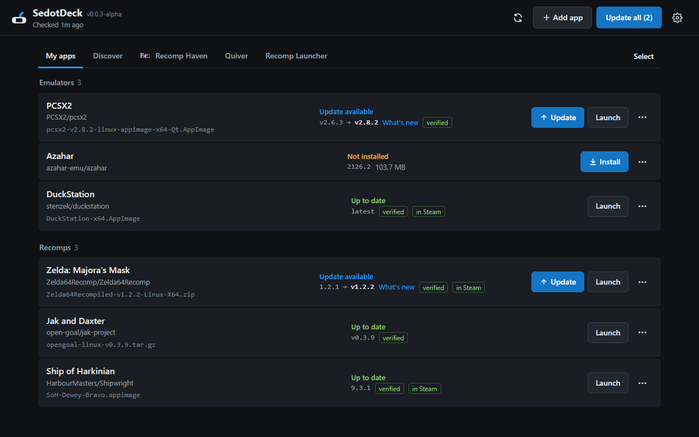
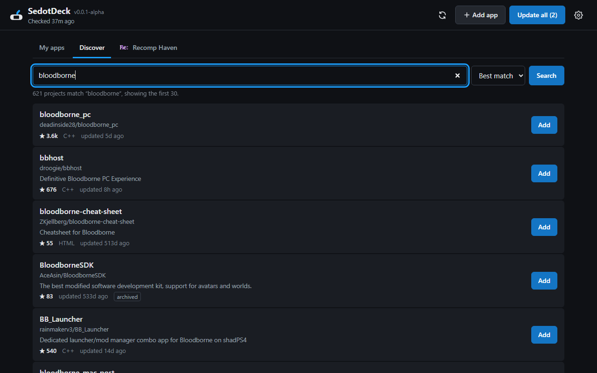
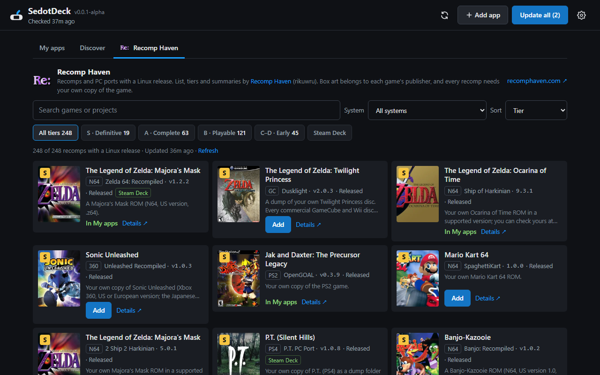
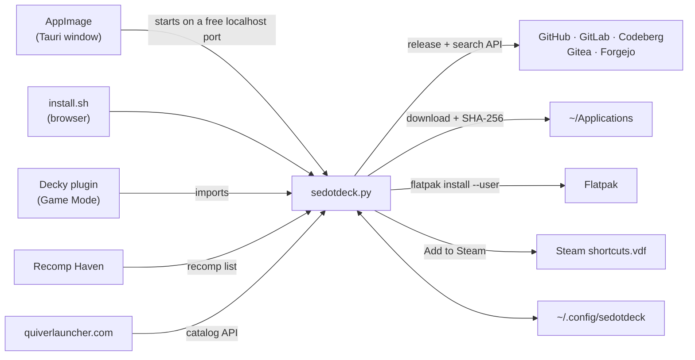

<div align="center">


# SedotDeck

**One place to keep every AppImage, Flatpak bundle and PC port on your Steam Deck up to date.**<br>
Paste a release link, search GitHub by a game's name, or pick a recomp from [Recomp Haven](https://recomphaven.com/) or the [Quiver](https://quiverlauncher.com/) catalog. SedotDeck checks, downloads, verifies and swaps the old version out without breaking your Steam shortcuts.


[Install](#install) · [Using it](#using-it) · [Discover](#discover-search-github) · [Recomp Haven](#recomp-haven) · [Quiver](#quiver-catalog) · [Folder ports](#folder-ports) · [FAQ](#faq) · [Credit](#credit) · [License](#license)



</div>

> [!IMPORTANT]
> **SedotDeck is heavily AI-made.** Nearly all of its code, this README and the logo were written by [Claude](https://claude.com/claude-code), Anthropic's AI, through Claude Code. I ([intermission88](https://github.com/intermission88)) decide what it does, review the changes and test it. Every commit made with Claude says so with `Co-Authored-By: Claude`. Details are in [Credit](#credit).

> SedotDeck is in alpha (0.0.x). It was called DeckPort before; your app list moves over by itself on first start.

## Features

- **Update all** in one click, for apps released on **GitHub, GitLab, Codeberg, Gitea and Forgejo**.
- **Picks the right Linux file by itself**: an AppImage first, then a `.flatpak` bundle, then a `linux`/`steamdeck` build in a zip or tar. Windows, macOS and ARM builds are skipped.
- **Discover**: search GitHub for a game or port by name and see each project's stars before you add it.
- **Recomp Haven tab**: hundreds of recomps and PC ports with a Linux release, filterable by tier and system.
- **Quiver tab**: ports and recomps from the [quiverlauncher.com](https://quiverlauncher.com/) catalog with a verified Linux release, filterable by system and AI use.
- **File paths never change**, so Steam shortcuts keep working after updates. **Add to Steam** works for AppImages, Flatpaks, folder ports and Windows `.exe` games through Proton.
- **AppImages you already have** in `~/Applications` are recognized and updated in place.
- **Safe**: SHA-256 verification, a `.old` backup with **Rollback**, and saves and configs in port folders are never touched.
- **Release control**: skip nightly releases, follow only the release marked **Latest**, **Skip** one version, and read **What's new** first.
- **Categories** and a **Select** mode for handling many apps at once.
- **Updates itself**: when a new SedotDeck release is out, it asks on start whether to update.
- **Decky plugin** for Game Mode, checking every 6 hours.
- **Light**: one Python file that runs on SteamOS's own Python. No `pip`, no `sudo`.

## Install

All three share the same app list and `~/Applications` folder, so you can install more than one. Downloads are on the [Releases](https://github.com/intermission88/SedotDeck/releases) page.

| Form | Runs in | Best for |
|---|---|---|
| **AppImage** `SedotDeck-x86_64.AppImage` | Desktop Mode | Its own window, no browser. **Recommended.** |
| **Decky plugin** `SedotDeck-decky-x.y.z.zip` | Game Mode | Updating without leaving Game Mode |
| **Script** `install.sh` | Desktop Mode | Smallest (about 100 KB), opens in a browser |

<details open>
<summary><b>AppImage (Desktop Mode)</b></summary>

1. Download `SedotDeck-x86_64.AppImage`. Its name has no version in it, so a newer download simply replaces the old file and a Steam shortcut to it keeps working.
2. Right-click it → **Properties** → **Permissions**, tick **Is executable**.
3. Double-click it.

It's about 80 MB because WebKitGTK is bundled; the only thing it needs from the system is `python3`, which SteamOS ships. The AppImage also works as a [CLI](#cli), and it can replace itself when you accept an update.
</details>

<details>
<summary><b>Decky plugin (Game Mode)</b></summary>

Needs [Decky Loader](https://decky.xyz).

1. Download `SedotDeck-decky-….zip` to the Deck. **Don't unzip it.**
2. **⋯** → **Decky** → **Settings** → **Developer**, turn on **Developer mode**.
3. **Install Plugin from ZIP File** and pick the ZIP.

Asset patterns and the GitHub token are set in the desktop version and the plugin uses them too. If you had the DeckPort plugin, uninstall it from Decky after installing this one.
</details>

<details>
<summary><b>Script (install.sh)</b></summary>

Copy this repository to the Deck (for example to `~/sedotdeck`), then in **Konsole**:

```bash
bash ~/sedotdeck/install.sh
```

Open **SedotDeck** from the app menu (*Utilities*). The script also removes an older DeckPort install.
</details>

## Using it

1. Press **Add app** and paste the repository link (`owner/repo` works too), search for it under **Discover**, or press **Add** in the **Recomp Haven** or **Quiver** tab.
2. The preview shows which file will be downloaded. Wrong one? Open **Advanced** and pick the right file.
3. **Install**. From then on, **Update all** is enough.
4. **⋯** → **Add to Steam**, once (in Desktop Mode, close Steam first; see the [FAQ](#faq)).

Each row shows the app's status, its version, **Install/Update** and **Launch**. Everything else (Check, Skip, Rollback, Add to Steam, Choose program, Category, Edit, Remove) is in the **⋯** menu.

### Categories and Select mode

Give an app a category with **⋯** → **Category…** and the list is grouped by it. Press **Select**, pick a few apps, then **Check**, **Update**, **Category…** or **Remove…** them together.

### Choosing releases

In **⋯** → **Edit** → **Advanced**. The preview updates as you type.

| Option | What it does |
|---|---|
| **Skip releases named** | Ignores releases whose title or tag match a regex, for example `nightly\|beta`. |
| **Only the release marked "Latest"** | Follows only the release the developer labelled Latest. |
| **Asset pattern** | Picks a specific file; click a file in the list and the pattern is filled in for you. |
| **Include pre-releases** | Also follows pre-releases. |

## Discover: search GitHub

The **Discover** tab searches GitHub repositories by name and description, for example `bloodborne` or `god of war 3`. Each result shows its stars, language and when it was last updated, and you can sort by **Best match** or **Most stars**.

 **Add** opens the usual dialog, which looks at the project's latest release and shows the file it would download before anything is saved.

Without a GitHub token, GitHub allows 10 searches a minute.

## Recomp Haven

[Recomp Haven](https://recomphaven.com/) tracks every game recompilation and PC port. SedotDeck's **Recomp Haven** tab lists the ones with a Linux release on GitHub, using the site's own logo, box art and tiers.



- Search by game or project, filter by **system** (console) or tier, or show only the ones marked **Steam Deck**.
- Sort by tier, system (grouped under a heading per console), stars, name or newest release.
- **Add** puts it in **My apps**; **Details ↗** opens its page on recomphaven.com.
- Projects that hand out game files (ROMs or ISOs) are not shown. Every recomp needs your own copy of the game.

## Quiver catalog

[quiverlauncher.com](https://quiverlauncher.com/) is the community catalog behind [Quiver Launcher](https://github.com/tgeorgiadis/quiver-launcher). SedotDeck's **Quiver** tab reads its public API and lists the apps with a Linux release that Quiver has verified, on GitHub or GitLab. SedotDeck isn't part of Quiver, and it doesn't use Quiver's name or logo for itself.

- Search by game, project or developer, filter by **system** or by how much **AI** went into the project (as the catalog labels it: no AI, AI-assisted or AI-generated).
- Sort by newly added, newest release, most recommended, system or name. Player reports from the site (how many recommend it or report it broken) show on each card.
- **Add** puts it in **My apps**; **Details ↗** opens its page on quiverlauncher.com.
- Every port needs your own copy of the game.

## Folder ports

A port released as a `.zip` or `.tar.gz` is extracted to `~/Applications/<Name>/`. Updates overwrite the release's files and delete files the old release had and the new one doesn't, without touching saves or configs.

To start it, SedotDeck writes a small launcher, `sedotdeck-launch.sh`, **inside that folder**. It changes into the game's folder and runs the program, so the Steam shortcut points at a path that never changes, even when a release renames its binary (`Game-1.0.x86_64` to `Game-1.1.x86_64`). Updates leave the launcher alone because it isn't part of any release.

Older versions put the launcher next to the folder as `~/Applications/<Name>.sh`. On the next update or program change, SedotDeck moves it into the folder, unless a Steam shortcut still points at the old one; then it stays so the shortcut keeps working. Remove that shortcut and use **Add to Steam** again to switch.

**⋯** → **Choose program…** picks which program runs, and the choice is kept across updates. With OpenGOAL, for example, pick `gk` (the game), not `goalc` (the compiler).

Picking an **`.exe`** means a Windows game. The Decky plugin turns Proton on for you. In Desktop Mode, turn it on yourself in Steam: **Properties** → **Compatibility** → **Force Proton**.

## Flatpak bundles

When a release ships a `.flatpak` bundle and no AppImage, SedotDeck installs it with `flatpak install --user`, and updates reinstall the new bundle. Your app data in `~/.var/app` stays. **Launch** and **Add to Steam** start it with `flatpak run <app id>`. Removing it with "Also delete its downloaded files" uninstalls it. Flatpaks have no `.old` backup, so Rollback isn't available for them.

Apps you installed from Flathub (through the KDE Discover store, say) are updated by Flatpak itself and aren't shown here.

## Already have the AppImage?

SedotDeck scans `~/Applications` and recognizes AppImages from the update information embedded in them (Vita3K and PPSSPP, for example). Press **Keep … up to date**: new versions are written to the same path and file name, so your Steam shortcut keeps working. Files it doesn't recognize can be linked with **Choose repo…** or hidden with **Hide**.

## CLI

<details>
<summary><b>The <code>sedotdeck</code> command</b> (from <code>install.sh</code>) or <code>./SedotDeck-…AppImage</code></summary>

```bash
sedotdeck add https://github.com/owner/repo --name "My Port"
sedotdeck add <repo> --pattern 'linux.*\.AppImage$'   # pick the asset yourself (regex)
sedotdeck add <repo> --pre                            # also follow pre-releases
sedotdeck add <repo> --adopt ~/Applications/Game-v1.1.AppImage
sedotdeck list
sedotdeck scan [--track]         # find AppImages already in ~/Applications
sedotdeck check
sedotdeck update                 # update everything that has a new version
sedotdeck update "My Port"       # update one app
sedotdeck remove "My Port" --delete-files
sedotdeck export apps.json       # back up or share the app list
sedotdeck import apps.json       # merge; apps already tracked are skipped
```
</details>

## FAQ

<details>
<summary><b>"GitHub rate limit hit"</b></summary>

Without signing in, GitHub allows 60 requests an hour (10 searches a minute). Create a *fine-grained* token with read-only access to public repositories at <https://github.com/settings/tokens> and paste it in **Settings**. The token is never included in exports.
</details>

<details>
<summary><b>SedotDeck picked the wrong file or release</b></summary>

**⋯** → **Edit** → **Advanced**: click the right file, or fill in **Skip releases named** (for example `nightly|beta`). See [Choosing releases](#choosing-releases).
</details>

<details>
<summary><b>A folder port can't be added to Steam</b></summary>

SedotDeck doesn't know which program to start yet. Use **⋯** → **Choose program…** and pick its `.sh`, binary or `.exe`.
</details>

<details>
<summary><b>Why do I have to close Steam for "Add to Steam"?</b></summary>

Steam rewrites `shortcuts.vdf` from memory when it exits. In Desktop Mode, exit Steam first, press **Add to Steam**, then start Steam again. The previous file is always kept as `shortcuts.vdf.sedotdeck.bak`. In Game Mode there's no need: the Decky plugin uses Steam's own API.
</details>

<details>
<summary><b>The AppImage won't open</b></summary>

Make sure **Is executable** is ticked (or run `chmod +x SedotDeck-x86_64.AppImage`). *"SedotDeck needs Python 3"* means your system has no `python3`; SteamOS includes it.
</details>

<details>
<summary><b>How do SedotDeck's own updates work?</b></summary>

On start, SedotDeck asks GitHub for its newest release (at most every 6 hours). If it's newer, you get **Update now**, **Later** or **Skip this version**. The AppImage downloads the new AppImage and replaces itself; the `install.sh` version replaces `sedotdeck.py`. Restart SedotDeck to use the new version. The Decky plugin can't replace itself, so it links to the release instead. You can check any time in **Settings**.
</details>

<details>
<summary><b>Where does SedotDeck keep its data?</b></summary>

- App list and settings: `~/.config/sedotdeck/config.json` (moved from `~/.config/deckport` if you used DeckPort)
- Recomp Haven cache (one day): `~/.config/sedotdeck/recomphaven.json`
- Quiver catalog cache (one day): `~/.config/sedotdeck/quiver.json`
- Games and apps: `~/Applications/` (change it in **Settings**)

SedotDeck sends no telemetry. It only contacts the forge APIs where releases live, GitHub's search when you use Discover, and Recomp Haven or quiverlauncher.com when their tab is open.
</details>

## How it works

<details>
<summary><b>Architecture and building it yourself</b></summary>



All the logic is in [`sedotdeck.py`](sedotdeck.py) (Python standard library only). [`desktop/`](desktop) is a Tauri shell that shows its UI in a native window, and [`decky-plugin/`](decky-plugin) calls the same code from Game Mode.

- **AppImage**: `cd desktop && npm ci && npm run build` (needs Rust, Node.js and the [Tauri dependencies](https://v2.tauri.app/start/prerequisites/#linux)).
- **Decky plugin**: `decky-plugin/package.sh` (needs Node.js 20+ and `zip`).
- **Tests**: `python3 -I tests/test_sedotdeck.py sedotdeck.py` (on Linux).

GitHub Actions builds both on every push to `main`, and `v*` tags are published as a Release.
</details>

## Credit

SedotDeck stands on other people's work. If something of yours is used here and isn't credited properly, please [open an issue](https://github.com/intermission88/SedotDeck/issues) and it will be fixed.

### Who made what

| Part | Made by |
|---|---|
| Idea, direction, feature choices, reviewing changes, testing, bug reports | [intermission88](https://github.com/intermission88) (human) |
| Almost all code: `sedotdeck.py`, the web UI, the Decky plugin, the Tauri shell, `install.sh`, tests, CI | [Claude](https://claude.com/claude-code) by Anthropic, through Claude Code |
| This README and the other docs | Claude, edited and approved by intermission88 |
| The logo (generated from geometry by [`design/logo/build_kit.py`](design/logo)) | Claude |
| Screenshots | Taken by Claude with a headless browser against a test setup |

So far every commit was made with Claude and is marked `Co-Authored-By: Claude`, so `git log` shows exactly which ones. SedotDeck isn't made or endorsed by Anthropic.

### Data and content shown in the app

| What | From |
|---|---|
| Recomp Haven tab: the list, tiers, summaries, system labels and logo | [Recomp Haven](https://recomphaven.com/) by [rikuwru](https://github.com/rikuwru/recomphaven) (MIT). Downloaded from its repository when the tab is opened, not copied into SedotDeck. |
| Recomp Haven's base data | [Recompendium](https://github.com/nio03/unricopie) (MIT) |
| Box art in the Recomp Haven tab | Belongs to each game's publisher; collected by Recomp Haven from [libretro thumbnails](https://thumbnails.libretro.com/) and Wikipedia |
| Quiver tab: the list, descriptions, AI-use labels, player reports and verified releases | The [quiverlauncher.com](https://quiverlauncher.com/) catalog by Thomas Georgiadis ([Quiver Launcher](https://github.com/tgeorgiadis/quiver-launcher)). Quiver's name and logo are its own marks. |
| Box art in the Quiver tab | Belongs to each game's publisher; collected by Quiver, mostly from [SteamGridDB](https://www.steamgriddb.com/) |
| Release info and the Discover search | The public APIs of GitHub, GitLab, Codeberg, Gitea and Forgejo |
| The emulators, recomps and ports you install | Their own developers. SedotDeck only downloads their releases; support them in their repositories. |

### Ideas taken from other projects

| Idea | From |
|---|---|
| The whole concept (track apps by their release page and update them in one place), release title filters, following only the "Latest" release, moved-repo detection, categories and bulk actions | [Obtainium](https://github.com/ImranR98/Obtainium) by ImranR98, the Android app that does this for APKs. SedotDeck copies its ideas, not its code (Obtainium is GPL-3.0 and written in Dart). |
| Recognizing AppImages from their embedded update information | The [AppImage update information spec](https://github.com/AppImage/AppImageSpec) |
| A look close to SteamOS | Valve's SteamOS interface. No Valve artwork or fonts are included. |

### Software SedotDeck uses

| Part | Software |
|---|---|
| Desktop window (AppImage) | [Tauri](https://v2.tauri.app) with `tauri-plugin-dialog`, and WebKitGTK |
| Game Mode plugin | [Decky Loader](https://decky.xyz) (`@decky/api`, `@decky/ui`, `@decky/rollup`) and [react-icons](https://react-icons.github.io/react-icons/) |
| Core | Python and its standard library, as shipped with SteamOS |
| Flatpak bundles | [Flatpak](https://flatpak.org) (`flatpak install --user`) |
| Windows games | [Proton](https://github.com/ValveSoftware/Proton) by Valve |
| Badges in this README | [Shields.io](https://shields.io) and [Simple Icons](https://simpleicons.org) |

### Tools used while building it

| Tool | Used for |
|---|---|
| [Claude Code](https://claude.com/claude-code) | Writing the code, docs and logo (see [Who made what](#who-made-what)) |
| [Anti Slop](https://github.com/miqdadbadjuber/anti-slop) by miqdadbadjuber (MIT) | Rules that steer Claude away from generic AI-looking UI and comments; kept in `.claude/skills/` |
| GitHub Actions | Building the AppImage and the Decky ZIP, and publishing releases |

### Trademarks

Steam, Steam Deck, SteamOS and Proton are trademarks of Valve Corporation. SedotDeck is a fan-made tool and isn't affiliated with or endorsed by Valve, Decky Loader, Recomp Haven, Obtainium or any game publisher.

## License

SedotDeck is released under the [MIT License](LICENSE). That covers SedotDeck's own code, docs and logo. The projects, data and box art listed in [Credit](#credit) keep their own licenses, and the apps you install with SedotDeck are under their developers' licenses.
