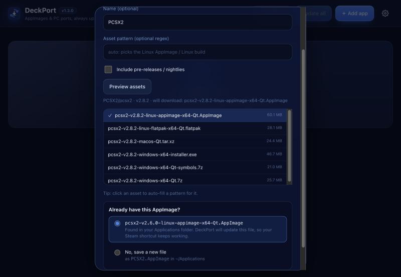

# DeckPort

Obtainium-style updater for Steam Deck. Kamu tambahkan link rilis dari PC port atau AppImage (GitHub, GitLab, Codeberg, Gitea, atau Forgejo), lalu DeckPort yang cek update, download, dan ganti file lamanya. Semua dikelola dari satu tempat.


- Cuma butuh Python bawaan SteamOS, tidak perlu `pip install` atau `sudo`.
- Web UI yang ramah touchscreen dan trackpad, plus CLI.
- Otomatis memilih asset Linux yang benar (AppImage dulu, lalu build `linux`/`steamdeck` dalam zip/tar). Bisa diganti dengan regex.
- **Nama file tetap** (`~/Applications/NamaGame.AppImage`), jadi shortcut Steam (non-Steam game) tidak rusak setelah update.
- **Pakai file yang sudah ada**: kalau kamu sudah punya `Game-v1.1-x86_64.AppImage` hasil download manual, DeckPort mengenalinya dan meng-update file itu juga, dengan nama yang sama. Shortcut Steam-mu tetap jalan.
- Status per app jelas terlihat dari ikon dan warnanya (biru = ada update, hijau = up to date, kuning = belum terpasang, merah = error). App yang butuh update selalu tampil paling atas.
- App yang sudah versi terbaru tidak bisa di-install ulang tanpa sengaja.
- Mendeteksi rilis "nightly"/"continuous" yang tag-nya sama tapi file-nya diganti.
- **Verifikasi SHA-256**: setiap download dicek dengan checksum dari GitHub, atau dari file checksum di rilis (`SHA256SUMS`, `*.sha256`). Kalau tidak cocok, file dihapus dan versi lama tetap dipakai.
- **GitHub, GitLab, Codeberg, Gitea, Forgejo**: untuk server self-hosted, jenisnya dideteksi otomatis.
- **Export/import daftar app** ke file JSON untuk backup atau dibagikan ke teman. Token dan path lokal tidak ikut.
- Versi sebelumnya disimpan sebagai `.old` dan bisa di-**Rollback**.
- Port berbentuk zip/tar diekstrak ke `~/Applications/NamaGame/` dengan cara menimpa file. File lain seperti save dan config tidak dihapus.

## Install di Steam Deck

DeckPort tersedia dalam tiga bentuk. Ketiganya memakai daftar app dan folder `~/Applications` yang sama, jadi boleh dipasang bersamaan.

| Bentuk | Dipakai di | Kelebihan |
|---|---|---|
| **AppImage** (`DeckPort-x.y.z-x86_64.AppImage`) | Desktop Mode | Aplikasi standalone dengan jendela sendiri, tidak butuh browser |
| **Plugin Decky** (`DeckPort-decky-x.y.z.zip`) | Game Mode (menu ⋯) | Update tanpa pindah ke Desktop, cek otomatis tiap 6 jam dengan notifikasi |
| **Script** (`install.sh`) | Desktop Mode | Paling ringan, tapi tampil di browser |

File AppImage dan ZIP Decky ada di halaman **Releases** repo ini, atau di artifact **appimage** dan **decky** di tab **Actions**.

### AppImage
1. Masuk **Desktop Mode**, lalu download `DeckPort-…-x86_64.AppImage` dari Releases.
2. Klik kanan file-nya, pilih **Properties** → **Permissions**, lalu centang **Is executable**.
3. Klik dua kali untuk membuka.

DeckPort terbuka sebagai aplikasi sendiri (dibuat dengan Tauri), jadi tidak butuh browser apa pun. Ukuran AppImage sekitar 70–90 MB karena mesin tampilannya ikut dibundel. Satu-satunya yang dibutuhkan adalah `python3`, yang sudah ada di SteamOS. Begitu jendelanya ditutup, DeckPort langsung berhenti. Kalau saat itu sedang ada download, download-nya diselesaikan dulu.

AppImage ini juga bisa dipakai sebagai CLI, misalnya `./DeckPort-…AppImage update`.

### Plugin Decky (Game Mode)
Butuh [Decky Loader](https://decky.xyz) yang sudah terpasang.
1. Download `DeckPort-decky-….zip` ke Deck.
2. Di Game Mode, buka menu **⋯** → **Decky** → ⚙ **Settings** → **Developer**, lalu aktifkan **Developer mode**.
3. Di menu **Developer**, pilih **Install Plugin from ZIP File** dan pilih file ZIP tadi.
4. DeckPort muncul di daftar plugin Decky. Isinya **Update all**, **Check for updates**, daftar app (tekan sebuah app untuk Check/Rollback/Remove), dan kolom **Add app**.

Pengaturan seperti asset pattern dan GitHub token diatur dari versi Desktop, lalu otomatis ikut terpakai di plugin.

### Script
Masuk **Desktop Mode**, copy folder ini ke Deck (misalnya ke `~/deckport`), lalu jalankan di **Konsole**:

```bash
bash ~/deckport/install.sh
```

Setelah itu buka **DeckPort** dari menu aplikasi (Utilities) atau dari ikon di Desktop.

## Build sendiri

- **AppImage** (di Linux x86_64): `cd desktop && npm ci && npm run build`. Butuh Rust, Node.js, dan [dependensi Tauri](https://v2.tauri.app/start/prerequisites/#linux) (`libwebkit2gtk-4.1-dev` dan lainnya). Hasilnya ada di `desktop/src-tauri/target/release/bundle/appimage/`. Untuk mencoba tanpa build: `cd desktop && npm run dev`.
- **Plugin Decky**: jalankan `decky-plugin/package.sh`. Butuh Node.js 20+ dan `zip`.
- **Tes**: jalankan `python3 -I tests/test_deckport.py deckport.py`.

GitHub Actions mem-build keduanya setiap ada push ke `main`. Kalau yang di-push tag `v*`, hasilnya juga dipublish sebagai Release.

## Sudah punya AppImage-nya?

Banyak rilis memakai nama file yang berisi versi. Kalau di `~/Applications` sudah ada file seperti `pcsx2-v2.6.0-linux-appimage-x64-Qt.AppImage` dan file itu sudah kamu jadikan shortcut Steam, caranya:

1. **＋ Add app**, paste link repo-nya, lalu klik **Preview assets**.
2. Di bagian **"Already have this AppImage?"**, DeckPort menunjukkan file yang cocok dan otomatis mencentangnya.
3. Klik **Add**. Kalau file lamanya ternyata sudah versi terbaru (dicek lewat SHA-256), statusnya langsung *Up to date*. Kalau belum, klik **Update**: versi baru ditulis ke **path dan nama file yang sama**, dan versi lama disimpan sebagai `.old`.



Lewat CLI: `deckport add https://github.com/PCSX2/pcsx2 --adopt ~/Applications/pcsx2-v2.6.0-linux-appimage-x64-Qt.AppImage`

| Sedang download | Sudah terpasang |
|---|---|
|  |  |

## Cara pakai

1. **＋ Add app**, lalu paste link seperti `https://github.com/owner/repo`, `https://gitlab.com/group/project`, atau `https://codeberg.org/owner/repo` (link `/releases` juga bisa).
2. Klik **Preview assets** untuk melihat file yang akan di-download. Kalau pilihannya salah, klik asset yang benar dan pattern-nya akan terisi otomatis.
3. **Install**, lalu nanti tinggal **Check all** dan **Update all**.
4. Tambahkan file `.AppImage` di `~/Applications` ke Steam (*Add a Non-Steam Game*) supaya bisa dimainkan dari Game Mode. Karena path-nya tidak berubah, shortcut tetap jalan setelah update.

### Rate limit GitHub

Ini hanya berlaku untuk GitHub. Tanpa login, GitHub cuma mengizinkan 60 request per jam. Kalau app yang kamu pantau banyak, buat token di <https://github.com/settings/tokens> (tipe fine-grained, akses *public repositories* read-only sudah cukup), lalu masukkan di **⚙ Settings**.

## CLI

```bash
deckport add https://github.com/owner/repo --name "My Port"
deckport list
deckport check
deckport update            # update semua yang ada versi barunya
deckport update "My Port"  # update satu app
deckport remove "My Port" --delete-files
deckport export daftar.json   # backup/bagikan daftar app
deckport import daftar.json   # gabungkan; yang sudah ada dilewati
```

Opsi `--pattern 'linux.*\.AppImage$'` dipakai untuk memilih asset secara manual, dan `--pre` untuk ikut memantau pre-release.

Data tersimpan di `~/.config/deckport/config.json`.
